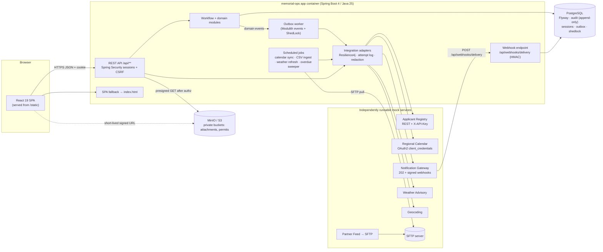
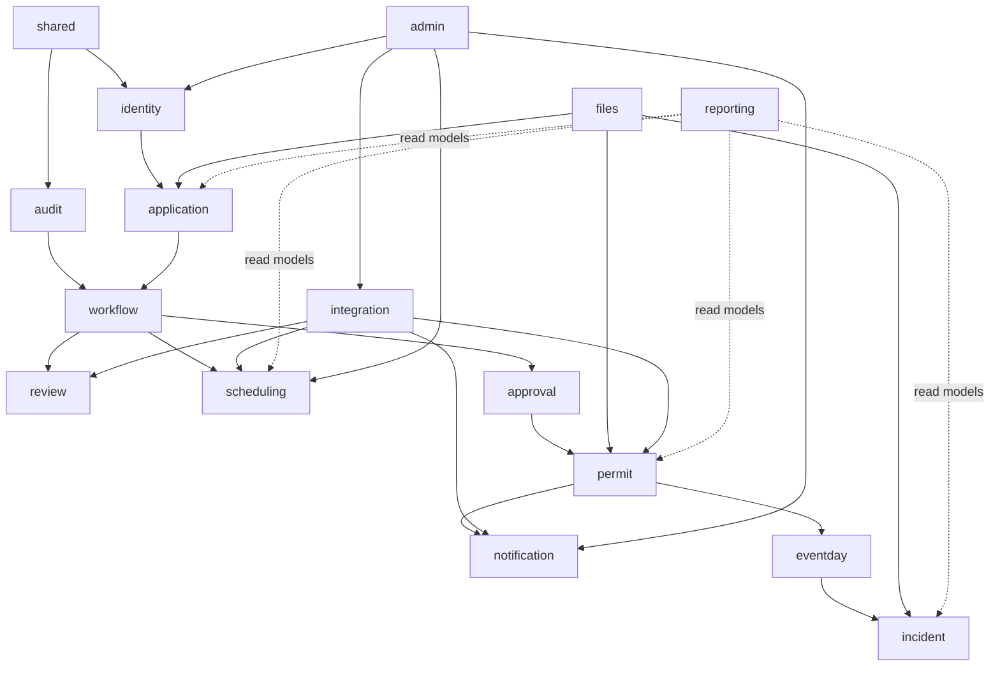
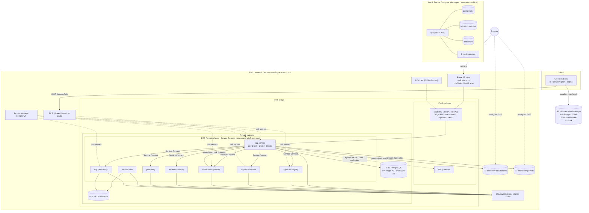

# Memorial Event Operations & Permit Case Management: Build Plan

**Source:** VA MISI Mock Build Brief 3 (Revised), *Memorial Event Operations & Permit Case Management*. This is a fictional practice exercise.
**Prepared for:** Alhagie Bai Cham, senior full-stack engineer
**Date:** October 15, 2026
**Target stack:** React 19 + TypeScript (Vite) · Java 25 + Spring Boot 4.1 · Gradle 9 with version catalog · PostgreSQL · MinIO · Docker / Docker Compose (local) · Terraform on AWS us-east-1 (ECS Fargate; workspaces `dev` / `prod`) · GitHub Actions CI/CD with OIDC

> The brief prefers ASP.NET Core / .NET 8 but says "Different stack allowed if documented and independently runnable." This plan meets that condition. Section 10 of the brief also says "Git (not GitHub) is required." Section 1.3 explains how a plain-Git submission fits with GitHub Actions CI/CD. **Local (Docker Compose) and cloud (AWS dev/prod) deployment are both in scope.**

---

## Contents

1. Stack sanity check, things you might have missed, Git/GitHub reconciliation, deployment assumptions
2. Architecture overview, workflow state machine, deployment topology (local and AWS), environment sizing
3. Backlog: epics and user stories across four tracks (UI/UX, Backend, Test Automation, DevOps)
4. Phased sprint plan (local and cloud from Sprint 0)
5. Traceability matrices and risks
6. AI coding-agent prompts (master prompt plus one per track)

**Revision 2 (Oct 15, 2026):** local Docker Compose and AWS cloud deployment are both first-class scope. Added the AWS us-east-1 design (Route 53 `wsllclabs.com`, ACM DNS validation, Terraform S3 backend `misi-va-code-challenges` with workspaces `dev`/`prod` and the native lockfile) and GitHub Actions CI/CD over OIDC with a prod approval gate. Also explains how a plain-Git submission fits with GitHub Actions, and how MinIO, SFTP, the mocks and secrets map to the cloud.

---

## 1. Stack sanity check

### 1.1 Verdict

The stack fits the brief well. A single Spring Boot service that serves the React SPA plus the REST API keeps the deployable simple, matches the brief's expectation of one application backed by independent mocks, and gives you strong options for transactions, security and testing. Before you scaffold, settle the following points.

| Area | Your choice | Assessment / recommendation |
|---|---|---|
| Frontend | React, responsive, animated, modern | **React 19 + TypeScript + Vite**, **React Router 7** (data/declarative mode, client-side only, with no SSR because Spring serves the static build), **TanStack Query 5** for server state, **TanStack Table** for server-paged grids, **React Hook Form + Zod** for client validation, **Tailwind CSS 4 + shadcn/ui (Radix primitives)** for accessible components, **Motion (Framer Motion)** for animation with `prefers-reduced-motion` honored, **FullCalendar** (MIT core: month/week/day) for page 07, **Recharts or Apache ECharts** for page 16, and **Leaflet + local static tiles** for page 26 (the brief says internet must not be required). |
| Backend | Java 25 + Spring Boot 4 | Java 25 is the current LTS. Spring Boot **4.1.x** supports Java 17–26 and Gradle 8.14+/9.x. Turn on virtual threads (`spring.threads.virtual.enabled=true`). Note the Boot 4 changes: **modular starters** (`spring-boot-starter-webmvc`, `spring-boot-starter-flyway`, `*-test` starters), **Jackson 3** (`tools.jackson` packages), **JSpecify** null-safety, built-in **API versioning** and **HTTP Service Clients** (`@HttpExchange`), which suit the seven adapters. |
| Build | Gradle + `gradle/libs.versions.toml` | Use a **multi-project Gradle build** (Kotlin DSL) with convention plugins in `build-logic/`. Drive the frontend from Gradle with the `com.github.node-gradle.node` plugin, or call `npm` through an `Exec` task, so `./gradlew build` produces one jar that already contains the SPA. |
| SPA in jar | Copy `dist/` to `src/main/resources/static` | Copy into **`build/resources/main/static`** (a `processResources` dependency) rather than into the source tree, so generated files never end up in Git. Add an **SPA fallback controller** that forwards non-`/api`, non-`/actuator`, non-asset, extension-less GETs to `index.html`. Serve hashed assets with long cache headers and `index.html` with `no-cache`. |
| Container | One Docker image (web + API) | Multi-stage build: `node:24` → `gradle:9-jdk25` → `eclipse-temurin:25-jre` (or a distroless Java 25 image). Run as non-root and add a HEALTHCHECK. Consider Spring Boot's **AOT cache / CDS** (Java 25) to start faster. Each mock service gets its own small image. |
| Local | Docker Compose (first-class) | Compose runs: `app`, `postgres`, `minio` (+ `minio-init` to create private buckets), `sftp` (atmoz/sftp), `applicant-registry`, `regional-calendar`, `notification-gateway`, `weather-advisory`, `geocoding`, `partner-feed` (writes CSVs to SFTP), plus optional `mailpit`. Add profiles: `core`, `mocks`, `full`. |
| Cloud | Terraform → AWS (first-class) | **ECS Fargate in us-east-1** fits better than App Runner: about 8 containers, private service-to-service traffic (**ECS Service Connect**), internal webhook callbacks from the gateway mock to the app, and SFTP on EFS. Supporting pieces: **RDS PostgreSQL 17 per environment**, **S3** (private, SSE, Block Public Access) in place of MinIO, **Secrets Manager**, **ALB + ACM** (DNS-validated) on **Route 53 `wsllclabs.com`** (`brief3-dev` / `brief3`, an assumption), **CloudWatch**, **ECR**, **WAF** on prod. Terraform state in `s3://misi-va-code-challenges` (key `brief-3/terraform.tfstate`, `use_lockfile = true`) with workspaces **`dev`** and **`prod`**. See §1.5, §2.9 and §2.10. |
| CI/CD | GitHub Actions | Use it as the team pipeline: build/test, Compose + Playwright E2E, push images to ECR, `terraform plan` on PRs, auto-apply **dev** on `main`, and **prod** behind a manual-approval GitHub environment. Authenticate to AWS through **OIDC roles only (no static keys)**. The submission stays a portable plain-Git bundle because the brief says "Git (not GitHub)". Every job calls a `make` target (§1.3). |

### 1.2 Things you might have missed

Each item is tied to the part of the brief that needs it.

**Persistence and domain**

1. **Flyway migrations** (`spring-boot-starter-flyway`). Versioned `V###__*.sql`, with no Hibernate `ddl-auto` outside tests. Use the Postgres types `timestamptz`, `uuid`, `citext` and `jsonb` (for integration payloads). *(§4 "migrations")*
2. **Optimistic locking**: `@Version` on every mutable aggregate. The API returns an `ETag` and expects `If-Match` (or a `version` field). A mismatch returns **409** as `application/problem+json` with the current server representation, which the UI uses for a merge/reload dialog. *(§5, FR-18)*
3. **Explicit state machine** with an allow-list transition table. Any other transition returns **422** with a problem type such as `urn:memorial-ops:invalid-transition`. The status change and its `AuditEvent` commit in the **same transaction**. *(§5)*
4. **Reference number generators** for `APP-YYYY-NNNNN` and `PER-YYYY-NNNNN`, using a per-year counter table with a `SELECT … FOR UPDATE` row lock (or one Postgres sequence per year) plus a unique constraint. Never derive them from `max()+1`. *(§4)*
5. **Append-only audit**: an `audit_event` table with a DB trigger that blocks `UPDATE`/`DELETE`, and the app's DB role granted only `INSERT, SELECT` on it. There is **no hard deletion** anywhere; use soft-delete or status. *(FR-18, Ops Manager prohibition)*
6. **Time zones**: store every instant as UTC `timestamptz`. Each venue/cemetery has an IANA zone, and conflicts are computed in UTC while the UI shows venue-local time with a zone label. Watch for DST in the 30–300 minute duration and buffer math. *(§4 "UTC audit timestamps")*
7. **Configurable business rules** (check-in window, buffer defaults, info-request due days, rate limits, override permissions) are stored in a `business_rule` table, editable on page 18, and audited. *(FR-14)*

**Security**

8. **Spring Security 7 with server-side sessions** (Spring Session JDBC, HttpOnly + Secure + SameSite=Lax cookie, **CSRF token** for the SPA through a cookie and header). For a same-origin SPA this is safer and simpler than JWT, and logout and deactivation take effect immediately. Use JWT only if you need it for the mocks. *(FR-01)*
9. **Method-level and record-level authorization** (`@PreAuthorize` plus a domain `CasePolicy`). Inaccessible IDs return 403 (or 404 for "not yours" cases) **with no private fields**. Attendant views use a reduced DTO projection. *(§3)*
10. **Separation of duties** as a domain rule: the approver must not be the eligibility reviewer of the same case, and System Admin cannot approve. Enforce it server-side and test it. *(§3, FR-08)*
11. **File validation**: extension + declared MIME + **magic bytes** (Apache Tika `tika-core` detection), 5 MB limit at the servlet and app layers, random object keys, SHA-256 checksum, private buckets, short-lived **pre-signed GET** only after the role check, and every download audited. *(FR-15, §7.1)*
12. **Secrets**: none in Git. Use `.env.example`, Compose `env_file`, AWS Secrets Manager → ECS task secrets, masked display on page 19, and **log redaction** (a Logback mask converter for `X-API-Key`, `Authorization`, `client_secret`, `signature`). Add a gitleaks pre-commit hook and CI step. *(§7, §10)*
13. **HMAC webhook verification**: HMAC-SHA256 over `timestamp + "." + rawBody`, compared in **constant time** (`MessageDigest.isEqual`), with a 5-minute tolerance. Invalid → 401, duplicate `eventId` → 200 no-op, and status never regresses from Delivered. *(§7.1)*

**Reliability and integration**

14. **Transactional outbox + background worker** for notifications and the calendar `POST /reservations`. **Spring Modulith's Event Publication Registry** is a good fit (a JDBC-backed outbox with republish on restart). The alternative is a hand-rolled `outbox_message` table polled with `FOR UPDATE SKIP LOCKED`. Gateway failure must **never** roll back a permit. *(§6, §7.1)*
15. **ShedLock** (JDBC provider) for every `@Scheduled` job: outbox dispatch, calendar sync, CSV ingestion, overdue info-request sweeper, weather cache refresh, link-expiry cleanup. *(§7.4 "scheduled jobs with locking")*
16. **Resilience4j 2.4+ (`resilience4j-spring-boot4`)** for circuit breaker, retry with bounded exponential backoff + jitter, time limiter and rate limiter per adapter. Retry **only transient** errors (5xx, timeouts, 429 with `Retry-After`); **404 is never retried**. Spring Framework 7's built-in `@Retryable` is lighter but has no circuit breaker. *(§7.1, §7.4)*
17. **Idempotency keys** on outbound gateway sends, on check-in/check-out commands, and on wizard submit (to prevent duplicate submits). Store them in an `idempotency_key` table with a unique constraint. *(FR-02, FR-10, §6)*
18. **Integration Attempt log**: one row per outbound/inbound call (request ID, correlation ID, adapter, endpoint, sanitized status code, latency, retry attempt, linked case ID, redacted request/response excerpt), immutable, with a detail route `/integrations/attempts/:id`. *(§7.2)*
19. **OAuth2 client credentials** via Spring Security's `OAuth2AuthorizedClientManager` (token cached server-side, refreshed before expiry, one replay on 401). `invalid_client` produces an admin-actionable error. *(§7.1, failure matrix)*
20. **Weather cache** persisted in the DB (`weather_snapshot` with `fetched_at`, `source_timestamp`), not only in memory, so "Stale" survives restarts and is never fabricated. *(§7.1)*

**Documents and output**

21. **PDF generation**: **OpenPDF** (LGPL/MPL) or **Apache PDFBox**. Alternatively, **openhtmltopdf** renders a Thymeleaf template so permits and run-of-show sheets share styling. **ZXing** produces the QR code. Each permit version is stored immutably in object storage with a checksum. *(FR-09)*
22. **Verifiable permit token**: a compact signed payload (for example `PER-2026-00042.v2.<exp>.<HMAC or Ed25519 sig>`), checked on page 14 for signature, version currency, status (valid/expired/cancelled/revoked) and check-in window. *(FR-10)*
23. **CSV**: Apache Commons CSV or Jackson CSV. Store batch, checksum and counts. Use a documented **partial-success policy** (valid rows commit, bad rows go to a downloadable error CSV) and dedupe on `partnerEventId + updatedAtUtc`. *(§7.1)*

**Contracts, tests and accessibility**

24. **OpenAPI** via **springdoc-openapi 3.x** (Boot 4 line). Generate TypeScript types/clients with `openapi-typescript` + `openapi-fetch` (or Orval) in the web build so the UI cannot drift from the API. Write a hand-authored OpenAPI file for each mock. *(§10 "API spec")*
25. **Testcontainers 2.x** (Postgres, MinIO, mock-service containers) with `@ServiceConnection`. **WireMock** for adapter unit/edge tests. **Pact JVM** (consumer = app adapters, provider = mock services) or Spring Cloud Contract for **contract tests per adapter**. **ArchUnit** or **Spring Modulith `verify()`** for module boundaries. *(§8)*
26. **Playwright** E2E (TypeScript) covering the full live journey, every page 01–26, the 403/422/409/retry demos and the failure matrix, with **@axe-core/playwright** on every page. Also **Vitest + React Testing Library + MSW** for components. *(FR-17, §8)*
27. **Mock call counters**: each mock exposes `GET /__admin/calls` and `POST /__admin/scenario` (success, slow, 401, 404, 409, 429, 500, timeout, duplicate callback, outage). Tests assert the counts to prove the UI made real requests, and a **Scenario Panel** in Admin drives them. *(§7.4, §8)*
28. **Structured JSON logs + correlation ID**: Spring Boot's built-in structured logging (`logging.structured.format.console=ecs` or `logstash`), a servlet filter that reads or creates `X-Correlation-ID`, puts it in MDC, propagates it to every outbound adapter call and returns it in the response and in problem details. Micrometer Tracing / OpenTelemetry are optional. *(FR-16)*
29. **Health**: Actuator `/actuator/health` with custom `HealthIndicator`s for db, object storage, notification gateway and each mock (grouped `liveness`/`readiness`), plus a role-safe summary at `/api/health`. *(FR-16)*
30. **Separate mock services** as small Spring Boot apps in the same Gradle build (`mocks/*`) that share a `mock-common` library for scenario toggles, latency injection, call counters and request logs. Each is runnable on its own with `./gradlew :mocks:applicant-registry:bootRun` or its own Docker image. *(§7 "independently runnable")*
31. **Deterministic seed data**: a `demo` Spring profile seeder (Java + Datafaker with a fixed random seed) that creates exactly the §9 volumes and is idempotent (`make seed` / `./gradlew :apps:api:seed`). Put seeded passwords **only in the README**. *(§9, FR-01)*
32. **Submission deliverables** count toward pass/fail: README (demo accounts, architecture, setup), **ERD** (generate it, for example with SchemaSpy, or write Mermaid `erDiagram`), workflow diagram, API spec (OpenAPI JSON/HTML), **automated test report** (JUnit + Playwright HTML merged, or Allure), **screenshots of all 26 pages** (generated by a Playwright script), **implementation log**, **known limitations**, plus ADRs that record the stack deviation. *(§10)*
33. **Accessibility**: keyboard-first operation, visible focus, skip link, landmarks, an `aria-live` region for toasts/409 dialogs, a text alternative for each chart (data table toggle), the calendar usable without drag, colour contrast ≥ 4.5:1 and reduced-motion support. *(FR-17)*
34. **No dead controls**: every button must work, so add a lint/test rule (a Playwright crawl that clicks each primary action on each page and expects no 404/500). *(§10)*

### 1.3 "Git, not GitHub" and CI/CD: how the two fit together

The brief says "Git (not GitHub) is required." The team still uses GitHub and GitHub Actions. The plan meets both:

- **Submission is plain Git.** The deliverable is a full-history Git repository exported as `git bundle create memorial-ops.bundle --all` (or a zipped clone). Nothing needed to build, test or run the system depends on GitHub: no GitHub Packages, no Actions-only build logic, no GitHub-hosted dependencies.
- **GitHub Actions is the team's CI/CD, not part of the product.** Every workflow job calls a `make` target (`make verify`, `make e2e`, `make image`, `make tf-plan ENV=dev`). An evaluator can reproduce the whole pipeline on a laptop from the bundle, and the workflows in `.github/workflows/` are simply ignored outside GitHub.
- **AWS authentication uses OIDC.** GitHub Actions assumes IAM roles through OpenID Connect, so no static AWS keys exist anywhere.
- **Local and cloud are both first-class.** The local Docker Compose stack meets the brief's clean-machine and "no paid cloud account" requirement and stays the primary way to evaluate the system. AWS `dev` and `prod` run the same images and configuration contract, deployed by Terraform and GitHub Actions. Every sprint ends deployed to `dev`.
- **Document the decision** in ADR-010 and in the README: what is submitted (bundle), what CI is (GitHub Actions), and how to run everything without GitHub.

### 1.4 Key architectural decisions (ADRs to write)

| ADR | Decision |
|---|---|
| ADR-001 | Java 25 / Spring Boot 4.1 / React 19 instead of .NET 8 (permitted deviation, §10). |
| ADR-002 | Modular monolith (Spring Modulith) with one deployable that serves SPA + API. |
| ADR-003 | Server-side session auth with CSRF rather than JWT. |
| ADR-004 | Explicit transition table with 422/409 semantics; audit in the same transaction. |
| ADR-005 | Transactional outbox for every outbound side effect after commit. |
| ADR-006 | Mocks as separate Spring Boot apps sharing a `mock-common` library; the same images run in Compose and on ECS. |
| ADR-007 | Partial-success CSV import policy. |
| ADR-008 | Permit token format and signing key rotation. |
| ADR-009 | Two first-class targets: local Docker Compose and AWS (ECS Fargate). Local↔cloud mapping: MinIO→S3, Compose network→ECS Service Connect, SFTP container→ECS service on EFS, `.env`→Secrets Manager. |
| ADR-010 | Plain-Git submission (bundle) with GitHub Actions as team CI/CD; all jobs call `make` targets; OIDC to AWS. |
| ADR-011 | Terraform: one `live` root with workspaces `dev`/`prod` in the shared S3 backend with the native lockfile; a separate `bootstrap` root for ECR, OIDC and CI roles. |
| ADR-012 | DNS/TLS: Route 53 zone `wsllclabs.com`, ACM DNS-validated certificate per environment, hostnames `brief3-dev` / `brief3` (assumption). |

### 1.5 Deployment assumptions to confirm

| # | Assumption | Default in this plan | Notes |
|---|---|---|---|
| A1 | AWS region | `us-east-1` | ACM certificates for the ALB must be in the same region as the ALB, so they are also in us-east-1. |
| A2 | Hostnames | dev `brief3-dev.wsllclabs.com`, prod `brief3.wsllclabs.com` | This is a proposal. The nested form `dev.brief3.wsllclabs.com` also works through the `hostname` variable. Confirm before the first apply. |
| A3 | Hosted zone | Existing public Route 53 zone `wsllclabs.com` in the same AWS account | Looked up with a data source, not created. If the zone is in another account, a cross-account role for the validation records is needed. |
| A4 | Terraform state | Bucket `misi-va-code-challenges` (exists, versioned, encrypted), key `brief-3/terraform.tfstate`, `use_lockfile = true` | The bucket is shared with other challenges, so IAM access is scoped to this brief's prefixes. |
| A5 | Workspaces | `dev`, `prod` | With the default `workspace_key_prefix = "env:"`, state is stored at `env:/dev/brief-3/terraform.tfstate` and `env:/prod/brief-3/terraform.tfstate`. `default` is blocked by a precondition. |
| A6 | Terraform version | ≥ 1.11 (S3-native locking GA) | Pinned in `required_version`. AWS provider 6.x. |
| A7 | GitHub | Repository `<org>/<repo>` with environments `dev` and `production` (production needs reviewers) | Role trust policies key on these exact `sub` claims. |
| A8 | OIDC provider | One per account; reuse if it already exists | Created by the bootstrap root only if missing. |
| A9 | Mocks in prod | Yes, as internal-only ECS services | No real providers exist (the exercise is fictional). The scenario panel is admin-only and audited. |
| A10 | Cost posture | Dev is minimal (single NAT, micro RDS, Fargate Spot mocks, optional scale-to-zero). Prod is modest HA (Multi-AZ RDS, 2+ app tasks). | See §2.10. |

---

## 2. Architecture overview

### 2.1 Repository layout (Gradle multi-project monorepo)

```
memorial-ops/
├─ settings.gradle.kts              # includes apps/*, mocks/*, libs/*
├─ build.gradle.kts                 # root: spotless, versions, aggregate test report
├─ gradle/libs.versions.toml        # single version catalog (Java, Spring, libs, plugins)
├─ build-logic/                     # convention plugins: java-conventions, spring-app, mock-service
├─ apps/
│  ├─ web/                          # React 19 + TS + Vite (package.json, src/, vitest, msw)
│  │  └─ src/{app,routes,features/*,components/ui,lib/api(generated),styles}
│  └─ api/                          # Spring Boot 4 app; bundles web/dist into static/
│     └─ src/main/java/.../memorialops/
│        ├─ shared/        (errors, problem+json, correlation, time, ids, idempotency)
│        ├─ identity/      (users, roles, sessions, policies)
│        ├─ audit/         (append-only audit, attempt log)
│        ├─ application/   (Application, Applicant, wizard, register, comments)
│        ├─ workflow/      (state machine, transition guards)
│        ├─ review/        (eligibility, checklist, info requests)
│        ├─ scheduling/    (venues, blackouts, reservations, resources, conflict engine)
│        ├─ approval/      (decisions, separation of duties)
│        ├─ permit/        (permit, versions, PDF, QR, token)
│        ├─ notification/  (templates, outbox, gateway adapter, webhooks)
│        ├─ eventday/      (roster, checklist, check-in/out)
│        ├─ incident/
│        ├─ reporting/     (KPIs, charts, CSV export)
│        ├─ admin/         (rules, templates, scenario panel proxy)
│        ├─ files/         (attachments, storage port, MinIO/S3 adapter)
│        └─ integration/   (registry, calendar, weather, partnerfeed, geocoding, hub)
├─ mocks/
│  ├─ mock-common/                  # scenario toggles, latency, call counters, request log
│  ├─ applicant-registry/           # REST + API key
│  ├─ regional-calendar/            # OAuth2 client_credentials + REST
│  ├─ notification-gateway/         # async 202 + signed webhooks back to app
│  ├─ weather-advisory/             # read-only REST, rate limit, outage
│  ├─ geocoding/                    # candidates w/ confidence, ambiguous ties
│  └─ partner-feed/                 # generates nightly CSVs into SFTP (good/bad rows)
├─ e2e/                             # Playwright + axe; journey, pages, failure matrix, screenshots
├─ infra/
│  ├─ docker/                       # Dockerfiles, compose.yaml, compose.override.yaml, minio-init, sftp keys (dev only)
│  └─ terraform/
│     ├─ bootstrap/                 # once per account: ECR repos, GitHub OIDC provider + CI roles (state: brief-3/bootstrap/…)
│     ├─ live/                      # one root, workspaces dev|prod; backend s3 misi-va-code-challenges, key brief-3/terraform.tfstate, use_lockfile
│     │  └─ env/{dev,prod}.tfvars   # sizing, hostname, flags (scenario_control_enabled, seed_on_deploy)
│     └─ modules/{network,dns-cert,alb,waf,ecs-cluster,ecs-service,rds,s3-storage,secrets,efs,observability}
├─ docs/
│  ├─ adr/  erd/  diagrams/  api/  test-report/  screenshots/
│  ├─ implementation-log.md  known-limitations.md  demo-script.md  runbook.md
├─ .github/workflows/               # ci.yml, terraform-plan.yml, deploy.yml (each job calls make targets)
├─ scripts/                         # seed, reset-db, gen-screenshots, gen-erd
├─ Makefile                         # up, down, seed, test, e2e, verify, image, docs
├─ .env.example  .gitignore  .gitleaks.toml  README.md
```

### 2.2 Version catalog sketch (`gradle/libs.versions.toml`)

When you scaffold, pin the latest patch of each line. The lines below were current as of October 2026.

```toml
[versions]
java = "25"
spring-boot = "4.1.1"
spring-modulith = "2.1.x"         # Boot 4 line
springdoc = "3.0.x"
resilience4j = "2.4.0"
shedlock = "6.x"
testcontainers = "2.0.x"         # managed by Boot; override only if needed
openpdf = "2.x"                  # or pdfbox = "3.0.x"
zxing = "3.5.x"
tika = "3.x"
commons-csv = "1.14.x"
awssdk = "2.3x.x"                # S3 client works with MinIO (path-style)
wiremock = "3.x"
pact = "4.6.x"
archunit = "1.4.x"
datafaker = "2.x"
node-plugin = "7.x"

[libraries]
boot-webmvc = { module = "org.springframework.boot:spring-boot-starter-webmvc" }
boot-security = { module = "org.springframework.boot:spring-boot-starter-security" }
boot-oauth2-client = { module = "org.springframework.boot:spring-boot-starter-oauth2-client" }
boot-data-jpa = { module = "org.springframework.boot:spring-boot-starter-data-jpa" }
boot-flyway = { module = "org.springframework.boot:spring-boot-starter-flyway" }
boot-validation = { module = "org.springframework.boot:spring-boot-starter-validation" }
boot-actuator = { module = "org.springframework.boot:spring-boot-starter-actuator" }
boot-session-jdbc = { module = "org.springframework.boot:spring-boot-starter-session-jdbc" }
flyway-postgres = { module = "org.flywaydb:flyway-database-postgresql" }
postgres = { module = "org.postgresql:postgresql" }
modulith-starter = { module = "org.springframework.modulith:spring-modulith-starter-jdbc", version.ref = "spring-modulith" }
springdoc-ui = { module = "org.springdoc:springdoc-openapi-starter-webmvc-ui", version.ref = "springdoc" }
resilience4j-boot = { module = "io.github.resilience4j:resilience4j-spring-boot4", version.ref = "resilience4j" }
shedlock-spring = { module = "net.javacrumbs.shedlock:shedlock-spring", version.ref = "shedlock" }
shedlock-jdbc = { module = "net.javacrumbs.shedlock:shedlock-provider-jdbc-template", version.ref = "shedlock" }
openpdf = { module = "com.github.librepdf:openpdf", version.ref = "openpdf" }
zxing-core = { module = "com.google.zxing:core", version.ref = "zxing" }
zxing-javase = { module = "com.google.zxing:javase", version.ref = "zxing" }
tika-core = { module = "org.apache.tika:tika-core", version.ref = "tika" }
commons-csv = { module = "org.apache.commons:commons-csv", version.ref = "commons-csv" }
aws-s3 = { module = "software.amazon.awssdk:s3", version.ref = "awssdk" }
datafaker = { module = "net.datafaker:datafaker", version.ref = "datafaker" }
tc-postgresql = { module = "org.testcontainers:testcontainers-postgresql" }
tc-minio = { module = "org.testcontainers:testcontainers-minio" }
tc-junit = { module = "org.testcontainers:testcontainers-junit-jupiter" }
wiremock = { module = "org.wiremock:wiremock-standalone", version.ref = "wiremock" }
pact-consumer = { module = "au.com.dius.pact.consumer:junit5", version.ref = "pact" }
pact-provider = { module = "au.com.dius.pact.provider:junit5spring", version.ref = "pact" }
archunit = { module = "com.tngtech.archunit:archunit-junit5", version.ref = "archunit" }

[plugins]
spring-boot = { id = "org.springframework.boot", version.ref = "spring-boot" }
node = { id = "com.github.node-gradle.node", version.ref = "node-plugin" }
```

### 2.3 Logical system context and container diagram (same in local and AWS)



### 2.4 Module dependency view (backend)



Spring Modulith `ApplicationModules.of(App.class).verify()` enforces these boundaries in a unit test. Cross-module side effects travel as domain events, for example `PermitIssued` → notification outbox and `CaseCancelled` → release reservations.

### 2.5 Request flow: permit issuance with outbox

```mermaid
sequenceDiagram
  autonumber
  participant M as Ops Manager (SPA)
  participant API as API
  participant DB as Postgres
  participant W as Outbox worker
  participant G as Notification Gateway mock
  M->>API: POST /api/cases/{id}/permit (If-Match: v7, X-Correlation-ID)
  API->>DB: BEGIN; check status=Approved, severe-weather ack, calendar reconciled
  API->>DB: insert Permit + PermitVersion, status→Permitted, AuditEvent, outbox(PermitIssued)
  API->>DB: COMMIT
  API-->>M: 201 permit v1 (PDF link via /api/permits/{id}/versions/1/download-link)
  W->>DB: poll outbox (SKIP LOCKED, ShedLock)
  W->>G: POST /messages (Idempotency-Key, correlation id)
  alt 202 Accepted
    G-->>W: messageId, Queued
    G--)API: POST /api/webhooks/delivery (X-Signature, X-Timestamp)
    API->>DB: verify HMAC/tolerance, dedupe eventId, monotonic status
  else 500 / timeout
    W->>DB: mark Failed (attempt log); permit stays Permitted; retry visible on page 12/22
  end
```

### 2.6 Workflow state machine

```mermaid
stateDiagram-v2
  [*] --> Draft
  Draft --> Submitted: Intake Coordinator · valid form + required attachment
  Submitted --> NeedsInformation: Eligibility Reviewer · missing items + due date
  NeedsInformation --> Submitted: Intake Coordinator · response supplied (history kept)
  Submitted --> Eligible: Reviewer · checklist complete + registry evidence (or permitted override)
  Submitted --> Rejected: Reviewer · reason required
  Eligible --> TentativelyReserved: Scheduling Officer · no collision, capacity valid
  TentativelyReserved --> PendingApproval: Scheduling Officer · reservation summary complete
  PendingApproval --> Approved: Ops Manager · not the case reviewer; calendar reconciled
  PendingApproval --> Rejected: Ops Manager · reason required
  Approved --> Permitted: Ops Manager · immutable permit version; severe weather acknowledged
  Permitted --> CheckedIn: Assigned Attendant · valid token, within check-in window
  CheckedIn --> EventCompleted: Attendant · checkout + readiness checklist done
  EventCompleted --> Closed: Ops Manager · no unresolved High/Critical incident

  Submitted --> Cancelled: Manager (reason)
  Eligible --> Cancelled: Manager (reason)
  TentativelyReserved --> Cancelled: Manager (reason)
  PendingApproval --> Cancelled: Manager (reason)
  Approved --> Cancelled: Manager (reason)
  Permitted --> Cancelled: Manager (reason) · release reservations, invalidate permit

  Rejected --> [*]
  Cancelled --> [*]
  Closed --> [*]
```



**Transition rules (implementation notes)**

- The transition table is code plus a mirrored DB check, and every row lists (`from`, `to`, `requiredRole`, `guards[]`). Any pair not in the table returns **422** `invalid-transition` with `allowedTransitions` in the problem body.
- "Rejected" records a `stage` (`ELIGIBILITY` or `APPROVAL`) so reports can tell the two apart.
- **Permit revocation** (Ops Manager, justification required) creates a new `PermitVersion` with status `Revoked`. The brief lists revoke as an Ops Manager capability. Model it as a permit-level action that also moves the case to `Cancelled` (a documented assumption), or as a permit status alone, and record the choice in known-limitations/ADR.
- Cancelling releases `Reservation` and `ResourceAllocation` rows (status `Released`, not deleted), invalidates the active permit version, enqueues a calendar release and a notification through the outbox, and writes an audit event, all in one transaction.
- Every transition endpoint takes `If-Match`. A stale version returns **409**.

### 2.7 Data model (ERD summary)

```mermaid
erDiagram
  CEMETERY ||--o{ VENUE : has
  VENUE ||--o{ VENUE_BLACKOUT : has
  VENUE ||--o{ VENUE_HOURS : has
  CEMETERY ||--o{ RESOURCE_INVENTORY : stocks
  RESOURCE_TYPE ||--o{ RESOURCE_INVENTORY : of
  APPLICANT ||--o{ APPLICATION : files
  APPLICATION ||--|| EVENT : describes
  EVENT_CATEGORY ||--o{ EVENT : classifies
  APPLICATION ||--o{ RESERVATION : holds
  VENUE ||--o{ RESERVATION : booked
  RESERVATION ||--o{ RESOURCE_ALLOCATION : allocates
  RESOURCE_TYPE ||--o{ RESOURCE_ALLOCATION : of
  APPLICATION ||--o{ ELIGIBILITY_REVIEW : reviewed
  APPLICATION ||--o{ INFORMATION_REQUEST : asks
  INFORMATION_REQUEST ||--o{ INFORMATION_RESPONSE : answered
  APPLICATION ||--o{ APPROVAL_DECISION : decided
  APPLICATION ||--o| PERMIT : issues
  PERMIT ||--o{ PERMIT_VERSION : versions
  APPLICATION ||--o{ NOTIFICATION : notifies
  NOTIFICATION ||--o{ DELIVERY_EVENT : receipts
  APPLICATION ||--o{ CHECK_IN : records
  APPLICATION ||--o{ INCIDENT : logs
  APPLICATION ||--o{ ATTACHMENT : has
  INCIDENT ||--o{ ATTACHMENT : photos
  APPLICATION ||--o{ COMMENT : has
  APPLICATION ||--o{ STATUS_HISTORY : transitions
  USER }o--o{ ROLE : assigned
  USER ||--o{ AUDIT_EVENT : acts
  APPLICATION ||--o{ INTEGRATION_ATTEMPT : correlates
  IMPORT_BATCH ||--o{ IMPORT_ROW_ERROR : has
  IMPORT_BATCH ||--o{ PARTNER_EVENT : yields
  EXTERNAL_CALENDAR_EVENT ||--o{ RECONCILIATION_ITEM : conflicts
  VENUE ||--o{ WEATHER_SNAPSHOT : forecast
  VENUE ||--o{ GEOCODE_RESULT : candidates
```



Supporting tables: `reference_counter`, `business_rule`, `notification_template`, `outbox / event_publication`, `idempotency_key`, `shedlock`, `spring_session`, `saved_view`, `registry_verification`, `oauth_token_cache` (if not in memory), `sync_cursor`, `permit_token_key`, `event_assignment` (attendant ↔ event), `readiness_checklist_item`, `weather_ack`.
Every mutable table has `id uuid`, `version bigint`, `created_at/updated_at timestamptz`, `created_by/updated_by`, and `deleted_at` where soft-delete applies.

### 2.8 Role permission matrix (server-enforced)

| Capability | Intake | Reviewer | Scheduler | Ops Mgr | Attendant | Auditor | Admin |
|---|---|---|---|---|---|---|---|
| Create/edit own draft, submit, respond to info requests | ✅ own | | | | | | |
| View cases | own | assigned/queue | Eligible+ | all | assigned events, minimal applicant fields | metadata only | config only |
| Eligibility pass/fail, request info, registry verify | | ✅ | | | | | |
| Reserve venue/resources, change tentative reservations | | | ✅ (no hard-closure override) | | | | |
| Approve/reject (not own reviewed case) | | | | ✅ | | | ❌ |
| Issue/revoke permit, cancel case, close case, resolve incident | | | | ✅ | | | |
| Check-in/out, log incident (assigned events) | | | | ✅ | ✅ | | |
| Download protected applicant documents | own | ✅ | ✅ (needed docs) | ✅ | ❌ | ❌ | ❌ |
| Reports, audit CSV export | | | | ✅ | | ✅ | |
| Users, roles, venues, rules, templates, integration config | | | | | | | ✅ |
| Delete audit logs | ❌ all roles | | | | | | |

### 2.9 Deployment topology: local and AWS

Both targets run the **same container images** and the **same configuration contract**. Only the profile (`local` vs `aws`) and where values come from (`.env` vs Secrets Manager / Terraform) differ.



**Local ↔ AWS mapping**

| Concern | Local (Compose) | AWS (dev / prod) |
|---|---|---|
| App (web + API) | `app` container, port 8080 | ECS Fargate service behind the ALB; same image by digest |
| TLS / hostname | `http://localhost:8080` (optional mkcert) | ACM certificate + Route 53 alias: `brief3-dev.wsllclabs.com`, `brief3.wsllclabs.com` |
| Database | `postgres:17` container + volume | RDS PostgreSQL 17 per workspace; RDS-managed master secret |
| Object storage | MinIO (path-style endpoint override, local user/policy) | S3 buckets `brief3-<env>-attachments` / `-permits`; task role; no endpoint override; CORS for the env hostname |
| SFTP | `atmoz/sftp` container + volume | `atmoz/sftp` ECS service on EFS, internal only (Transfer Family as a documented alternative) |
| Mock services | Compose services on the default network | Internal ECS services in a Service Connect namespace; no ALB, no public ingress |
| Webhook callback | `http://app:8080/api/webhooks/delivery` | `http://app:8080/api/webhooks/delivery` via Service Connect; edge-blocked publicly |
| Scenario control | Always on (Admin panel) | `scenario_control_enabled` var; admin-only, audited; nightly reset on prod |
| Secrets | `.env` generated by `make init` | Secrets Manager `brief3/<env>/*` → ECS task `secrets` |
| Scheduled jobs / locks | ShedLock in Postgres | Same (ShedLock in RDS), safe with 2+ tasks |
| Sessions | Spring Session JDBC | Same (no sticky sessions) |
| Logs | JSON to stdout (`docker compose logs`) | JSON to CloudWatch Logs; Logs Insights by correlation ID |
| Seed data | `make seed` | One-off ECS task (`seed_on_deploy`) |
| Deploy | `make up` | GitHub Actions → Terraform workspace apply |

### 2.10 Environment sizing (dev vs prod)

| Item | dev | prod |
|---|---|---|
| App tasks | 1 × (1 vCPU / 2 GB) | min 2, max 4 × (1 vCPU / 2 GB), autoscaling on CPU and requests |
| Mock tasks | 1 each × (0.25 vCPU / 0.5 GB), **Fargate Spot** | 1 each × (0.25 vCPU / 0.5 GB), on-demand |
| SFTP | 1 task (0.25 / 0.5) + EFS (bursting) | same |
| RDS | `db.t4g.micro`, single-AZ, 20 GB gp3, 1-day backups, no deletion protection, skip final snapshot | `db.t4g.small` (or `medium`), **Multi-AZ**, 50 GB gp3 autoscaling, 7–14-day backups, deletion protection, final snapshot, Performance Insights |
| NAT | 1 NAT gateway | 1 per AZ (or 1 + VPC endpoints; documented trade-off) |
| VPC endpoints | S3 gateway; interface endpoints optional | S3 gateway + ECR, Secrets Manager, CloudWatch Logs interface endpoints |
| WAF | off (optional) | AWS managed rule groups + rate limit |
| Log retention | 14 days | 90 days |
| ALB access logs | off | on (S3) |
| Alarms | basic (email optional) | full set → SNS email |
| ECS Exec | on | off by default (break-glass) |
| Scale to zero | optional nightly schedule | no |
| Scenario control | on | on, admin-only and audited (can be disabled) |
| Deploy | auto on push to `main` | manual approval (GitHub `production` environment), same image digest as dev |


---

## 3. Backlog

**Conventions**

- IDs: `UX-` (UI/UX), `BE-` (Backend), `TA-` (Test Automation), `DO-` (DevOps). Each epic is `<track>-E<n>` and each story is `<track>-<n>.<m>`.
- Story format: *As a … I want … so that …*, followed by acceptance criteria (AC).
- **Definition of Done for every story:** server-side validation and authorization in place; client validation mirrors the server; loading, empty and error states built; keyboard operable with no axe violations; responsive at 360 px, 768 px and 1280 px; unit/integration tests merged; OpenAPI updated; audit events emitted for mutations; no dead controls; no lorem ipsum.
- Route paths are suggestions. Each page has its own route and its own navigation entry, and is never a modal or tab.

| # | Page | Route |
|---|---|---|
| 01 | Operations Dashboard | `/dashboard` |
| 02 | Application Register | `/applications` |
| 03 | New Application Wizard | `/applications/new/:step` (and `/applications/:id/edit/:step` to resume) |
| 04 | Application Detail | `/applications/:id` |
| 05 | Eligibility Review Queue | `/reviews` |
| 06 | Request Information Inbox | `/information-requests` |
| 07 | Event Calendar | `/calendar?view=month\|week\|day` |
| 08 | Venue Availability | `/venues/availability` |
| 09 | Resource Planner | `/resources` |
| 10 | Approval Workspace | `/approvals` |
| 11 | Permit Center | `/permits` |
| 12 | Notification Center | `/notifications` |
| 13 | Daily Event Roster | `/roster?date=&site=` |
| 14 | Event Check-In | `/check-in` |
| 15 | Incident Register | `/incidents` |
| 16 | Reports & Exports | `/reports` |
| 17 | Administration: Venues | `/admin/venues` |
| 18 | Administration: Users & Rules | `/admin/users-rules` (sub-sections: users, rules, templates, audit viewer) |
| 19 | External Integration Hub | `/integrations` (and `/integrations/attempts/:id`) |
| 20 | Applicant Registry Verification | `/integrations/registry` |
| 21 | Regional Calendar Sync | `/integrations/calendar` |
| 22 | Messaging Delivery Monitor | `/integrations/messaging` |
| 23 | Document Vault | `/documents` |
| 24 | Weather & Advisories | `/integrations/weather` |
| 25 | Data Import & Reconciliation | `/integrations/imports` |
| 26 | Geolocation & Venue Map | `/integrations/geo` |

Supporting non-counted routes: `/login`, `/403`, `/404`, `/admin/scenarios` (mock scenario panel), `/integrations/attempts/:id`.

---

### Track A: UI/UX

#### UX-E1: Design system, app shell and cross-cutting UX

**UX-1.1 Design tokens and component library**
As a developer, I want one design system (Tailwind 4 tokens + shadcn/ui on Radix) so that every page looks consistent and is accessible by default.
AC: colour tokens meet 4.5:1 text and 3:1 UI contrast; light theme required and dark theme optional; components include Button, Input, Select, Combobox, DatePicker, DateTimeRange, DataTable, Badge (one per workflow status), Card, Dialog, Drawer, Toast, Tabs (used within a page only), Stepper, EmptyState, ErrorState, Skeleton, ConfirmDialog with required reason; a Storybook or Ladle catalog is optional.

**UX-1.2 Responsive app shell with role-aware navigation**
As any signed-in user, I want a sidebar or top-nav that shows only the pages my role may use so that I am not offered actions I cannot take.
AC: navigation comes from `/api/me` capabilities, not hard-coded roles; collapses to a drawer below 1024 px; shows the current user, role and logout; breadcrumbs; skip-to-content link; `<main>`, `<nav>` and `<header>` landmarks; the active route is announced; hidden routes still return 403 from the server when typed directly.

**UX-1.3 Motion and micro-interactions**
As a user, I want subtle, purposeful animation so that the app feels modern without being distracting.
AC: Motion (Framer Motion) is used for page transitions, list reorder, toast enter/exit, the wizard step slide and KPI count-up; every animation is disabled or reduced under `prefers-reduced-motion`; no animation exceeds 300 ms on interactive feedback; animations never block input.

**UX-1.4 Global error, problem+json and 403/404/422 handling**
As a user, I want clear messages when something fails so that I know what to do next.
AC: one API client maps `application/problem+json` to typed errors; 401 redirects to login and preserves the return URL; 403 shows an "Access denied" page with no record details; 404 shows a not-found page; 422 invalid-transition shows the allowed next actions; network/timeout errors show a retry button; every error shows the correlation ID with a copy button.

**UX-1.5 Concurrency conflict (409) merge/reload dialog**
As a user editing a record, I want to be told when someone else changed it so that I don't overwrite their work.
AC: on 409 a dialog opens with a field-level diff of my values against the server values and offers "Reload theirs", "Keep mine and re-apply" (re-submits with the new version) and "Cancel"; focus is trapped and returned; the message is announced through `aria-live`; the dialog works on the wizard, application detail, venue admin, rules and reservations.

**UX-1.6 Form patterns and client validation**
As a user, I want inline validation that matches the server so that I can fix errors before I submit.
AC: React Hook Form + Zod schemas are derived from or kept in sync with the OpenAPI constraints; errors are linked through `aria-describedby`; an error summary at the top of the form takes focus on submit; server field errors map back onto the matching inputs; the submit button disables while pending (prevents duplicate submits) and sends an idempotency key.

**UX-1.7 Tables, filters and deep links**
As a user, I want filters, sort and page encoded in the URL so that I can bookmark and share filtered views.
AC: a shared `useUrlState` hook; server paging at 20 rows; sortable column headers with `aria-sort`; filter chips; reset button; the row count is announced; tables render as cards on mobile.

**UX-1.8 Time zone display**
As a user, I want times shown in the venue's local time with a zone label so that I never misread an event time.
AC: every timestamp component takes an instant (UTC) plus a zone; tooltip shows UTC; date pickers send ISO-8601 with an offset; DST edge cases are covered by tests.

**UX-1.9 Login and logout page**
As a user, I want a simple, accessible login so that I can start work quickly.
AC: username/password form, error message with no user-enumeration hint, CSRF handled, "signed out" confirmation, a session-expiry warning toast at T-2 minutes, demo credentials **not** shown in the UI (they live in the README only).

#### UX-E2: Operations Dashboard (page 01)

**UX-2.1 KPI cards with click-through**
As an Operations Manager, I want KPI cards (open cases by status, events today, pending approvals, overdue info requests, open High/Critical incidents, failed notifications, integrations degraded) so that I can see where attention is needed.
AC: values come from `/api/dashboard` (calculated, not hard-coded); each card links to the target page with its filters pre-set (for example `/applications?status=PendingApproval`); skeletons while loading; each card shows when it was last refreshed.

**UX-2.2 Today's events, pending actions, incidents and deadlines panels**
As any staff role, I want lists of today's events, my pending actions, recent incidents and upcoming deadlines so that I can plan my day.
AC: panels are filtered by role capability; each item links to its detail page; empty states read "Nothing due today"; Attendants see only their assigned events.

#### UX-E3: Applications (pages 02, 03, 04)

**UX-3.1 Application Register (02)**
As a staff user, I want a server-paged, searchable register so that I can find any case I'm allowed to see.
AC: free-text search (reference, applicant name, event title); filters for status (multi), cemetery/site, venue, event type, applicant, date range; 20 rows per page; server sort; CSV export of the current filter; deep links keep filters (FR-03); the Intake role sees only own cases.

**UX-3.2 Saved views**
As a reviewer, I want to save and name filter combinations so that I can return to my usual queue quickly.
AC: create, rename, delete and set-default saved views, stored per user server-side; a view loads into the URL state.

**UX-3.3 New Application Wizard (03): four steps**
As an Intake Coordinator, I want a four-step wizard (Applicant → Event → Facilities → Supporting documents) so that I can capture an application in manageable chunks.
AC: a stepper shows progress and completion; each step validates on Next; Back keeps data; step 2 enforces a future date, 30–300 minute duration and attendee count ≥ 1 and ≤ venue capacity (live capacity check); step 3 picks resources with live availability hints; step 4 uploads PDF/PNG/JPG ≤ 5 MB with progress, type/size errors and at least one required document type; the review summary has a Submit button that disables and uses an idempotency key.

**UX-3.4 Draft autosave and resume**
As an Intake Coordinator, I want my draft saved automatically so that I don't lose work.
AC: autosave runs 1.5 s after the last edit and on step change; a "Saved hh:mm" indicator is shown with `aria-live="polite"`; a draft appears in "My drafts" on the register and the dashboard; reopening goes to the last step; autosave conflicts trigger the 409 dialog.

**UX-3.5 Application Detail (04)**
As a staff user, I want a case summary with editable sections according to status so that I can act on the case in one place.
AC: header shows reference, status badge, venue/time and owner; sections are Applicant, Event, Facilities/Reservations, Documents, Eligibility, Information Requests, Approval, Permit, Check-ins, Incidents; edit rights follow the status and role matrix (for example the event is editable only in Draft or Needs Information); a timeline shows status history and audit, including Rejected and Cancelled history; comments are threaded with author and time; an action bar shows only permitted transitions (from `/api/cases/{id}/actions`); reason dialogs for reject/cancel/revoke.

**UX-3.6 Cancel case flow**
As an Operations Manager, I want to cancel a case with a reason so that its reservations are released and the permit is invalidated.
AC: available only in the allowed states; the reason is required (min 10 chars); a confirmation lists the side effects (reservations released, permit invalidated, notification queued); the timeline updates.

#### UX-E4: Eligibility and information requests (pages 05, 06)

**UX-4.1 Eligibility Review Queue (05)**
As an Eligibility Reviewer, I want a queue of submitted applications with document review and the event-rule checklist so that I can decide efficiently.
AC: queue sorted by age with an SLA badge; opening a case shows a split view (documents preview + checklist); the checklist items are configured rules plus required documents; buttons for Request information, Pass (disabled until the checklist is complete and registry evidence exists or an override is recorded) and Reject (reason required); registry verification status is shown inline (Valid/Flagged/Unknown/Pending).

**UX-4.2 Registry override**
As an Eligibility Reviewer, I want to record an override for a Flagged or Unknown registry result when the rules allow it so that legitimate cases can proceed.
AC: the override is offered only when the rule `registry.override.allowed` permits it for that status; justification is required; it appears on the timeline and in the audit trail.

**UX-4.3 Request Information Inbox (06)**
As an Intake Coordinator or Reviewer, I want to track clarification requests, due dates and responses so that cases don't stall.
AC: tabs within the page (Open, Responded, Overdue, Closed); due-date badge (overdue in red with an icon, not colour alone); the coordinator responds with text and attachments and then resubmits; earlier requests and responses stay visible; the reviewer sees response history per case.

#### UX-E5: Scheduling (pages 07, 08, 09)

**UX-5.1 Event Calendar (07)**
As a Scheduling Officer, I want month, week and day views of persisted reservations filtered by cemetery and venue so that I can see availability.
AC: FullCalendar with the views switched by URL param; events coloured by status, with a legend and a pattern for colour-blind users; blackouts shown as background events; external calendar events shown as a distinct layer; clicking an empty slot opens "Propose reservation" (prefilled) on an Eligible case; keyboard navigation with a list-view fallback; drag/drop optional.

**UX-5.2 Venue Availability (08)**
As a Scheduling Officer, I want to see capacity, opening hours, blackouts and setup/teardown buffers with live collision checking so that I can pick a valid slot.
AC: venue picker + date; timeline strip showing hours, blackouts, existing reservations with buffers shaded; the proposed slot form validates through `/api/scheduling/check` with debounce and lists each conflict reason (overlap incl. buffer, blackout, capacity, closed hours, external calendar); "Suggest alternatives" shows the next free slots; hard closures cannot be overridden.

**UX-5.3 Resource Planner (09)**
As a Scheduling Officer, I want to allocate chairs, tents, parking attendants and AV kits with remaining stock and conflict warnings so that resources are never over-committed.
AC: a grid of resource types × time window shows remaining quantity; the allocation form blocks quantity > available; conflicts list competing reservations; allocations are released visibly on cancel; "Move to Pending Approval" is enabled when the reservation summary is complete.

#### UX-E6: Approvals and permits (pages 10, 11)

**UX-6.1 Approval Workspace (10)**
As an Operations Manager, I want pending approvals with decision notes and a digital sign-off so that decisions are recorded properly.
AC: list of Pending Approval cases; detail panel with reservation summary, review history, weather advisory and calendar reconciliation status; Approve/Reject with notes (reason required for reject); the sign-off confirmation shows name, role and UTC time; cases I reviewed show "You reviewed this case: approval not permitted" with the controls disabled, and the server still enforces it; Approve is blocked with an explanation when calendar reconciliation is pending.

**UX-6.2 Permit Center (11)**
As an Operations Manager, I want to issue, view, re-issue and revoke versioned permits so that event staff have an authoritative document.
AC: list of permits with number, version, status (Active/Superseded/Revoked/Expired), venue and time; Issue requires the severe-weather acknowledgement when an advisory is active (checkbox + note); a PDF preview (embedded viewer) plus a download button using a short-lived link; the version history is immutable; Revoke requires a justification; the QR code and typed token are shown on the detail view.

#### UX-E7: Notifications (page 12)

**UX-7.1 Notification Center (12)**
As an Operations Manager or Admin, I want a template-driven outbox with delivery status, retry and manual notifications so that I can make sure applicants were informed.
AC: outbox table (Queued/Sent/Delivered/Failed) with filters; detail shows the rendered template, attempts and webhook receipts; Retry (only on Failed, idempotent, confirms first); "Send manual notification" form (choose template or free text, recipient from case); the audit trail per message.

#### UX-E8: Event day (pages 13, 14, 15)

**UX-8.1 Daily Event Roster (13)**
As an Event Attendant, I want my roster for a date and site with readiness flags and a staff checklist so that I can prepare.
AC: date and site pickers (Attendant defaults to today and assigned site); each row shows time, venue, readiness flags (permit active, resources staged, weather OK) and a checklist with progress; a printable run-of-show (print CSS and/or server PDF); attendants see only assigned events with limited applicant fields.

**UX-8.2 Event Check-In (14)**
As an Event Attendant, I want to verify a permit by QR scan or typed code and record arrival and departure so that attendance is recorded accurately.
AC: camera QR scanning (for example `@zxing/browser` or the BarcodeDetector API) with a typed-code fallback; the result card clearly separates **Valid** (green + icon), **Expired**, **Cancelled/Revoked**, **Outside window** and **Not assigned to you**, using text and icons as well as colour; Check in / Check out buttons are idempotent (a double tap does not duplicate); offline-tolerant messaging; large touch targets on mobile.

**UX-8.3 Incident Register (15)**
As an Attendant or Manager, I want to capture incidents with severity, photos, follow-up owner, due date and corrective action so that issues are tracked to resolution.
AC: create form linked to an event; severity Low/Medium/High/Critical; photo upload (PNG/JPG ≤ 5 MB) with preview; owner and due date; escalation action (notifies Ops Manager); a resolution with notes is audited; filters by severity/status/site; High/Critical unresolved incidents are flagged on case detail as blocking closure.

#### UX-E9: Reports (page 16)

**UX-9.1 Reports & Exports (16)**
As an Ops Manager or Compliance Auditor, I want charts for throughput, approval time, venue utilization and incidents with filters, drilldowns and CSV so that I can analyse operations.
AC: date range + cemetery/venue filters in the URL; charts (throughput by week, median/p90 approval time, utilization % by venue, incidents by severity) are computed server-side; clicking a bar/segment drills down to a filtered register or incident list; a "View as table" toggle for each chart (a11y); CSV export of each dataset and of the audit log (auditor); no decorative-only charts.

#### UX-E10: Administration (pages 17, 18)

**UX-10.1 Venues admin (17)**
As a System Admin, I want to manage cemeteries, venues, capacities, operating hours, closure windows (blackouts, hard closures), resource inventories and event categories so that scheduling rules reflect reality.
AC: list + edit page with sections; hours editor per weekday; blackout CRUD with type (soft/hard); inventory per site; category CRUD; a geocode button links to page 26; deactivate instead of delete; 409 handling.

**UX-10.2 Users & Rules admin (18)**
As a System Admin, I want to assign roles, activate or deactivate users, edit rule thresholds and notification templates, and view the audit log so that the system is governed.
AC: users table with role multi-select and an active toggle (deactivation ends sessions); rules editor with typed values and validation (check-in window minutes, default buffers, info-request due days, override policy, weather cache TTL read-only); template editor with variables and a preview; audit viewer with filters (actor, entity, action, date) that is read-only, has no delete control, and exports to CSV.

**UX-10.3 Mock Scenario Panel**
As a demonstrator, I want to switch each mock service between success, slow, 401, 404, 409, 429, 500, timeout, duplicate callback and outage so that I can show the failure matrix live.
AC: Admin-only page; per-mock current mode and call counters; buttons call the app, which proxies to each mock's `/__admin/scenario`; the change is audited.

#### UX-E11: Integration pages (pages 19–26)

**UX-11.1 External Integration Hub (19)**
As a System Admin, I want live status cards for all seven integrations so that I can see health at a glance.
AC: each card shows a healthy/degraded/offline badge, request totals (24 h), error rate, last successful sync and the most recent errors; masked config (base URL and `••••` secret status, never values); a "Test connection" button that performs a real call; clicking an error opens the Integration Attempt detail (request ID, correlation ID, sanitized status, timing, retry attempt, linked case).

**UX-11.2 Applicant Registry Verification (20)**
As an Eligibility Reviewer, I want to look up an applicant reference against the registry and see match results, retry and history so that eligibility is evidence-based.
AC: lookup form; result shows referenceId, matchedName, eligibilityStatus and verifiedAt; 429 shows "Pending verification, retrying at hh:mm:ss"; 404 shows "No record" with no retry offered; verification history table; link to the case.

**UX-11.3 Regional Calendar Sync (21)**
As a Scheduling Officer, I want OAuth2 connection status, sync/refresh controls, external conflicts and a reconciliation queue so that double-bookings are caught.
AC: connection card (token status: valid until hh:mm, never the token); Sync now, last sync cursor and time; a list of imported external events; a conflicts queue with the source event, the local reservation, alternative slots and actions (Move local / Mark resolved with note / Retry push); reconciliation history; `invalid_client` shows an admin-actionable banner.

**UX-11.4 Messaging Delivery Monitor (22)**
As an Ops Manager, I want the email/SMS queue, webhook receipts, failed deliveries and correlation IDs with safe manual retry so that I can resolve delivery problems.
AC: queue table with status timeline per message (Queued→Sent→Delivered/Failed, regressions never shown); webhook receipts with signature verdict (Valid/Invalid/Replay/Duplicate); retry on Failed only, with confirmation and an idempotency notice; filters by correlation ID.

**UX-11.5 Document Vault (23)**
As an authorized user, I want to upload, download and preview attachments with metadata, link expiry and audit history so that documents are managed securely.
AC: list filtered by case/type/uploader; metadata (size, MIME, checksum, uploader, created); preview for images/PDFs through a short-lived link; the link expiry countdown is visible; an expired link shows "Link expired" and a "Regenerate link" action if permitted; per-document audit history; Auditor sees metadata only, with no download control.

**UX-11.6 Weather & Advisories (24)**
As an Ops Manager, I want forecasts per venue and date with the source timestamp, a severe advisory marker, manual refresh and a stale indicator so that weather risk is visible.
AC: venue + date picker; forecast card showing source timestamp, fetched time and a Fresh/Stale badge; a severe advisory banner with an icon; Refresh button (respects rate limits); on timeout the cached data is shown with a **Stale** label and is never fabricated; with no cache, shows "Forecast unavailable"; a list of upcoming events with risk flags; an Acknowledge action for managers.

**UX-11.7 Data Import & Reconciliation (25)**
As a Scheduling Officer or Admin, I want to upload or fetch partner CSVs, preview mappings, see row errors, dedupe and view sync results so that partner events are reconciled.
AC: Upload CSV and "Fetch from SFTP" buttons; preview of the first 20 rows with column mapping; Validate & Import; result card (batch ID, checksum, total/valid/invalid/duplicate counts); downloadable error report CSV; batch history; Replay batch; a re-import shows "0 new, N duplicates".

**UX-11.8 Geolocation & Venue Map (26)**
As a System Admin, I want to geocode venue addresses and see venues on a map or list with coordinate details and failure fallback so that location data is trustworthy.
AC: geocode a venue address; candidate list (label, lat/long, confidence); tied candidates require an explicit choice; coordinates are persisted only after Confirm; offline geocoder shows "Service unavailable: venue saved as Unverified"; Leaflet map with local static tiles (or an SVG fallback) plus an accessible list view; an Unverified badge.

#### UX-E12: Accessibility and polish hardening

**UX-12.1 WCAG 2.1 AA audit pass**
As a keyboard or screen-reader user, I want every page to be fully operable so that I can do my job.
AC: zero serious/critical axe violations on pages 01–26; manual keyboard walkthrough checklist per page; focus order logical; dialogs restore focus; charts have tables; calendar has a list alternative; form errors are announced.

**UX-12.2 Mobile and print polish**
As an Attendant on a phone, I want check-in, roster and incidents to work well on small screens so that I can use them on site.
AC: tested at 360 × 740; touch targets ≥ 44 px; print styles for the roster run-of-show and permit preview.

---

### Track B: Backend

#### BE-E1: Foundation and platform

**BE-1.1 Project skeleton and module boundaries**
As a developer, I want a Spring Boot 4.1 / Java 25 app with Spring Modulith modules so that features stay decoupled.
AC: packages as in §2.1; `ModularityTests` verifies the module graph; virtual threads on; `@ConfigurationProperties` records for every adapter (base URL, timeouts, credentials from env); profiles `local`, `test`, `demo`, `aws`.

**BE-1.2 Error model (problem+json)**
As an API consumer, I want consistent RFC 9457 problem responses so that the UI can handle errors uniformly.
AC: `@RestControllerAdvice` maps validation→400 (field errors), auth→401, authz→403 (no entity details), not-found→404, optimistic lock→409 (with `currentVersion` and `current` payload), invalid transition→422 (with `allowedTransitions`), rate-limited→429, upstream failure→502/503/504; every problem includes `correlationId` and a `type` URI.

**BE-1.3 Correlation ID and structured logs**
As an operator, I want JSON logs with correlation IDs so that I can trace a request across the app and the mocks.
AC: a filter accepts or creates `X-Correlation-ID` (UUID), puts it in MDC and echoes it on the response; RestClient interceptor propagates it to mocks; the outbox stores and restores it for async work; `logging.structured.format.console=ecs`; a redaction converter masks secrets and PII fields.

**BE-1.4 Health and observability**
As an operator, I want health endpoints for the app, DB, storage, notification gateway and each mock so that I can see degradation (FR-16).
AC: Actuator health groups `liveness` and `readiness`; custom `HealthIndicator`s per integration (status UP/DEGRADED/DOWN based on a circuit breaker state and last probe); `/api/health` summary for the UI; Micrometer metrics per adapter (calls, errors, latency) exposed at `/actuator/prometheus` (secured).

**BE-1.5 Clock and time handling**
As a developer, I want an injectable `Clock` and UTC everywhere so that time logic is testable.
AC: all `Instant` in UTC; venue zone stored as IANA ID; conflict and window logic unit-tested across DST transitions; JSON serializes ISO-8601 with `Z`.

**BE-1.6 OpenAPI**
As a frontend developer, I want an accurate OpenAPI 3.1 spec so that I can generate a typed client.
AC: springdoc 3.x; every endpoint documented with roles, problem responses and examples; `/v3/api-docs` exported to `docs/api/openapi.json` at build; a CI check fails if the spec changed without the regenerated client.

#### BE-E2: Data model and migrations

**BE-2.1 Flyway baseline schema**
As a developer, I want versioned migrations for all entities so that setup is repeatable on a clean machine.
AC: all §4 entities plus the supporting tables in §2.7; FKs, unique constraints (`reference`, permit number, `external_id`, `partner_event_id`, idempotency keys), check constraints (duration 30–300, attendee ≥ 1), `timestamptz`, `version` columns; indexes for the register filters.

**BE-2.2 Append-only audit store**
As a Compliance Auditor, I want an immutable audit log so that history can be trusted.
AC: `audit_event(id, occurred_at, actor_id, actor_role, action, entity_type, entity_id, before jsonb, after jsonb, correlation_id, ip)`; a trigger raises on UPDATE/DELETE; the app DB role has INSERT/SELECT only (a separate migration role); an audit row is written in the same transaction as every mutation.

**BE-2.3 Reference number generation**
As a case worker, I want unique `APP-YYYY-NNNNN` and `PER-YYYY-NNNNN` references so that cases and permits are easy to cite.
AC: generated in the same transaction as the insert; gap-tolerant but never duplicated under concurrency (tested with 50 parallel inserts); the year rolls over on the 1st of January (UTC, documented).

**BE-2.4 Soft delete and row versioning**
As an auditor, I want nothing hard-deleted so that history is preserved (FR-18).
AC: no `DELETE` endpoints for business entities; deactivate/cancel/release semantics; `@Version` on all aggregates; ETag/If-Match support in controllers.

#### BE-E3: Identity, authentication and authorization

**BE-3.1 Local login/logout with sessions**
As a user, I want to sign in with a local account so that I can access my role's functions (FR-01).
AC: Spring Security form/JSON login at `/api/auth/login`, logout at `/api/auth/logout`; BCrypt/Argon2 passwords; Spring Session JDBC; cookie HttpOnly/Secure/SameSite=Lax; CSRF through `CookieCsrfTokenRepository` + `X-XSRF-TOKEN`; inactive users cannot log in and their sessions are revoked; login throttling (5 attempts/min/user).

**BE-3.2 Capabilities endpoint**
As the SPA, I want `/api/me` with roles and capability flags so that navigation is role-aware.
AC: returns user, roles, capabilities (e.g. `CASE_APPROVE`, `PERMIT_ISSUE`), assigned sites/events for attendants.

**BE-3.3 Endpoint and record-level authorization**
As a security reviewer, I want every endpoint and download authorized server-side so that no role can exceed its permissions (§3).
AC: `@PreAuthorize` on every controller method (an ArchUnit test fails if one is missing); a `CasePolicy` checks ownership (Intake: own cases), assignment (Attendant: assigned events) and stage (Scheduler: Eligible+); forbidden returns 403 without private details; Attendant and Auditor get projection DTOs without protected applicant fields; Auditor cannot download protected documents; Admin cannot approve.

**BE-3.4 Separation of duties**
As an Ops Manager, I want the system to stop me approving a case I reviewed so that decisions stay independent (FR-08).
AC: approve/reject checks `eligibility_review.reviewer_id != current user`; returns 403 problem `separation-of-duties`; also enforced for Reviewer → Approver dual-role users; covered by tests.

#### BE-E4: Workflow engine

**BE-4.1 Transition table and guards**
As a developer, I want a single workflow service that owns all status changes so that rules can't be bypassed (§5).
AC: `WorkflowService.transition(caseId, target, command, expectedVersion)`; the table encodes from/to/role/guards; guards cover: form valid + required attachment; checklist complete + registry evidence/override; no collision + capacity; reservation summary complete; approver ≠ reviewer + calendar reconciled; permit generated + severe-weather ack; token valid + window; checkout + checklist; no unresolved High/Critical incidents; reason for reject/cancel/revoke. Unknown transition → 422. Stale → 409.

**BE-4.2 Status history and audit atomicity**
As an auditor, I want each status change and its audit record committed together so that history never diverges.
AC: `status_history` row + `audit_event` row in the same transaction; an integration test proves rollback of both when a guard throws after the write.

**BE-4.3 Available actions endpoint**
As the SPA, I want `/api/cases/{id}/actions` so that the UI shows only permitted actions.
AC: evaluates role + guards and returns enabled actions with reasons for disabled ones.

**BE-4.4 Cancellation side effects**
As an Ops Manager, I want cancellation to release everything cleanly so that resources become available again (FR-07).
AC: reservations and allocations → `Released`; the active permit version → `Cancelled`; outbox events for calendar release and applicant notification; audit; idempotent if repeated (second call → 422 because already Cancelled).

#### BE-E5: Applications

**BE-5.1 Draft CRUD and autosave**
As an Intake Coordinator, I want to create and autosave drafts per wizard step so that I can resume later (FR-02).
AC: `POST /api/applications` (draft), `PATCH /api/applications/{id}/steps/{step}` with If-Match; partial validation per step; full validation on submit; only the owner may edit.

**BE-5.2 Submit with duplicate-submit protection**
As an Intake Coordinator, I want submit to be safe to click twice so that I don't create duplicates.
AC: `POST /api/applications/{id}/submit` with an `Idempotency-Key`; the second identical request returns the same 200 result; validates a future event date (UTC now, venue zone), duration 30–300, attendees 1..capacity, applicant name + contact, at least one required attachment.

**BE-5.3 Register query API**
As a staff user, I want a paged search API so that the register is fast (FR-03).
AC: `GET /api/applications?q=&status=&cemetery=&venue=&eventType=&applicant=&from=&to=&sort=&page=&size=20`; uses JPA Specifications or jOOQ/Querydsl; role scoping applied in the query; CSV export endpoint streams the same filter; saved views CRUD at `/api/saved-views`.

**BE-5.4 Comments and timeline**
As a staff user, I want comments and a merged timeline so that collaboration is recorded.
AC: comments are append-only (edits create a new revision); the timeline merges status history, comments, decisions, notifications and integration attempts, filtered by role.

#### BE-E6: Eligibility review and information requests

**BE-6.1 Eligibility checklist**
As a Reviewer, I want a rules-driven checklist with required documents so that reviews are consistent (FR-04).
AC: checklist items come from the category + `business_rule` config; each item has pass/fail/NA + note; Pass requires all mandatory items and registry evidence (Valid) or a permitted override; Reject requires a reason; decisions are stored in `eligibility_review`.

**BE-6.2 Information requests**
As a Reviewer, I want to request information with a due date so that missing items are tracked.
AC: creating a request moves the case to Needs Information and records items + due date (default from rule); the coordinator response stores text + attachments and moves the case back to Submitted; old requests are preserved; a scheduled ShedLock job flags overdue requests and enqueues reminders.

#### BE-E7: Scheduling, conflict engine and resources

**BE-7.1 Venue, hours and blackout model**
As a Scheduling Officer, I want accurate venue rules so that conflicts are detected correctly.
AC: venue capacity, per-weekday opening hours (venue zone), default setup/teardown buffers, blackouts with soft/hard type; Postgres `tstzrange` columns with GiST indexes for overlap queries.

**BE-7.2 Conflict engine**
As a Scheduling Officer, I want every proposed slot checked for collisions so that double-booking cannot happen (FR-06).
AC: `POST /api/scheduling/check` returns a list of typed violations: `OVERLAP` (including buffers), `BLACKOUT_SOFT`/`BLACKOUT_HARD`, `OUTSIDE_HOURS`, `CAPACITY`, `RESOURCE_SHORTAGE`, `EXTERNAL_CALENDAR`; the same engine runs inside the reserve transaction; a Postgres `EXCLUDE USING gist` constraint on active reservations is the last line of defence; hard closures can never be overridden; alternative-slot suggestions (next N free slots).

**BE-7.3 Reservations**
As a Scheduling Officer, I want to create and change tentative reservations so that cases move toward approval.
AC: reserve moves Eligible → Tentatively Reserved; edits allowed only in Tentatively Reserved; "submit for approval" moves to Pending Approval once the summary is complete; the reservation is pushed to the regional calendar through the outbox.

**BE-7.4 Resource inventory and allocation**
As a Scheduling Officer, I want inventory tracked by site/date/time so that allocations never exceed stock (FR-07).
AC: availability = inventory − sum(overlapping active allocations, incl. buffers); allocation requests exceeding availability → 422 with shortage detail; row locking (`SELECT … FOR UPDATE` on the inventory row) prevents races; release on cancel.

**BE-7.5 Calendar read API**
As the SPA, I want reservations, blackouts and external events for a date range so that the calendar renders persisted data (FR-05).
AC: `GET /api/calendar?from=&to=&cemetery=&venue=` returns typed items; bounded range (max 62 days).

#### BE-E8: Approvals

**BE-8.1 Approve/reject with sign-off**
As an Ops Manager, I want timestamped decisions with a digital sign-off record so that approvals are accountable (FR-08).
AC: `approval_decision(decision, notes, signed_by, signed_role, signed_at, signature_hash)`, where the signature hash covers the case snapshot; reject requires a reason; separation of duties enforced; approval blocked while calendar reconciliation is pending or failed (§7.1); decision history immutable.

#### BE-E9: Permits

**BE-9.1 Permit issuance and versions**
As an Ops Manager, I want an immutable versioned permit so that the issued document can't be altered (FR-09).
AC: issuing creates `Permit` (PER-YYYY-NNNNN) + `PermitVersion` v1 with issuer and time; re-issue creates v(n+1) and supersedes the previous one; revoke creates a revoked version with a justification; blocked if a severe weather advisory is unacknowledged; notification enqueued via outbox (never inline).

**BE-9.2 PDF rendering with QR**
As event staff, I want a printable PDF with permit number, schedule, venue, conditions/restrictions and a QR token so that the permit can be verified.
AC: OpenPDF/openhtmltopdf template; ZXing QR of the signed token; PDF stored in the private `permits` bucket with SHA-256; download only through an authorized short-lived link; deterministic rendering tested (text extraction asserts the fields).

**BE-9.3 Permit token**
As an Attendant, I want a tamper-evident token so that forged permits are detected.
AC: token = `permitNumber.version.expiry.signature` (HMAC-SHA256 with a key from secrets and a key ID for rotation); verification checks signature, current version, status and expiry.

#### BE-E10: Notifications, outbox and webhooks

**BE-10.1 Templates and rendering**
As an Admin, I want template-driven messages so that wording is managed centrally (FR-12).
AC: `notification_template(code, channel, subject, body, variables)`; rendering with escaped variables; preview endpoint; template edits audited and versioned.

**BE-10.2 Transactional outbox worker**
As an operator, I want outbound messages sent after commit by a background worker so that permit issuance never depends on the gateway.
AC: Modulith event publication (or an `outbox` table) written in the business transaction; a worker under ShedLock dispatches with an `Idempotency-Key = notificationId`; Resilience4j retry (bounded exponential + jitter) for 5xx/timeout; status Queued → Sent → Delivered/Failed; a permanent failure marks the message Failed and is visible; manual retry re-enqueues with the same idempotency key, so the gateway dedupes.

**BE-10.3 Notification Gateway adapter**
As the system, I want to call `POST /messages` (202 + messageId) and `GET /messages/{id}` so that delivery is tracked.
AC: `@HttpExchange` client; API key from env; timeouts (connect 2 s, read 5 s); every call writes an `integration_attempt`; a status poll fallback runs when no webhook arrives within N minutes.

**BE-10.4 Delivery webhook endpoint**
As the system, I want to accept signed delivery callbacks safely so that status is accurate and forgery is rejected.
AC: `POST /api/webhooks/delivery` (CSRF-exempt, not session-authenticated); read the raw body; verify `X-Signature` = HMAC-SHA256(secret, `X-Timestamp + "." + body`) in constant time; reject when `|now − timestamp| > 300 s` → 401; invalid signature → 401; duplicate `eventId` → 200 no-op; out-of-order events never regress Delivered; every receipt stored immutably with its verdict.

#### BE-E11: Event day

**BE-11.1 Roster and readiness**
As an Attendant, I want a date/site roster with readiness flags and checklist so that I can prepare (page 13).
AC: `GET /api/roster?date=&site=` scoped to the assignment; readiness = permit active, resources allocated, checklist items, weather status; checklist item toggles are audited; run-of-show PDF endpoint.

**BE-11.2 Check-in/check-out**
As an Attendant, I want idempotent check-in and check-out so that duplicates can't occur (FR-10).
AC: `POST /api/check-ins/verify {token}` returns Valid/Expired/Cancelled/Revoked/OutsideWindow/NotAssigned/Invalid; `POST /api/check-ins` and `/check-outs` with an Idempotency-Key; the check-in window comes from a rule (e.g. 60 min before start until end); Permitted → Checked In; checkout + complete checklist → Event Completed.

#### BE-E12: Incidents

**BE-12.1 Incident lifecycle**
As an Attendant or Manager, I want incidents with severity, photos, owner, due date, corrective action, escalation and audited resolution (FR-11).
AC: statuses Open → In Progress → Resolved (Closed optional); escalation sends an outbox notification to Ops Managers; photos stored through the files module; unresolved High/Critical blocks case closure (422 with a reason).

#### BE-E13: Reporting

**BE-13.1 KPI and chart queries**
As an Ops Manager or Auditor, I want calculated metrics so that reports reflect real data (FR-13).
AC: endpoints for dashboard KPIs, throughput by period, approval time (submitted → approved, median/p90), venue utilization (booked minutes incl. buffers / open minutes), incidents by severity/site; all filtered by date range and site; SQL views or jOOQ queries; tests compare against seeded expectations.

**BE-13.2 CSV exports**
As an Auditor, I want filtered CSV exports, including the audit log, so that I can analyse offline.
AC: streaming CSV (no full in-memory load); formula-injection-safe (prefix `=+-@` cells with `'`); the export itself is audited.

#### BE-E14: Administration and rules

**BE-14.1 Venue/blackout/inventory/category CRUD**
As an Admin, I want to manage reference data (FR-14).
AC: CRUD with deactivation, validation, 409 handling and audit; blackout changes re-validate future tentative reservations and flag conflicts.

**BE-14.2 Users and roles**
As an Admin, I want to assign roles and activate or deactivate users.
AC: at least one role required; deactivation revokes sessions; an admin cannot remove their own last admin role; audited.

**BE-14.3 Business rules**
As an Admin, I want typed, validated rule settings so that thresholds can change without a deploy.
AC: `business_rule(key, type, value, min, max, description)`; cached with eviction on change; audited before/after values.

**BE-14.4 Scenario control proxy**
As a demonstrator, I want the app to read and set mock scenarios so that the failure matrix can be shown from the UI.
AC: `GET/PUT /api/admin/scenarios/{service}` proxies to `/__admin/scenario`; `GET /api/admin/scenarios/{service}/calls` returns call counts; Admin only; governed in AWS by the Terraform flag `scenario_control_enabled` (dev on; prod admin-only, audited, nightly reset to `success`; see DO-9.3).

#### BE-E15: Files and object storage

**BE-15.1 Storage port with MinIO/S3 adapter**
As a developer, I want one storage abstraction so that MinIO locally and S3 in AWS behave the same.
AC: AWS SDK v2 S3 client with path-style access for MinIO; private buckets `attachments` and `permits`; least-privilege credentials (a bucket-scoped policy); random UUID object keys.

**BE-15.2 Upload validation**
As a security reviewer, I want strict upload validation so that malicious files are rejected (FR-15).
AC: allow-list PDF/PNG/JPG; extension, declared MIME and Tika magic-byte detection must agree; max 5 MB (multipart limit + stream check); SHA-256 checksum; uploader and audit recorded; rejected uploads return 400/415/413 with clear reasons; an optional ClamAV hook is documented.

**BE-15.3 Authorized download links**
As an authorized user, I want short-lived download links so that documents stay private.
AC: `POST /api/attachments/{id}/download-link` checks the role/record policy, then returns a pre-signed URL (TTL from rule, e.g. 5 min) and audits it; the expired link fails on the storage side (403); the regenerate endpoint is role-checked; Auditor is denied for protected applicant documents.

#### BE-E16: External integrations (the seven patterns)

**BE-16.1 Integration framework**
As a developer, I want shared adapter infrastructure so that all seven integrations log, redact, retry and report health the same way.
AC: base `IntegrationClient` with RestClient + Resilience4j (circuit breaker, retry, time limiter, rate limiter per adapter); `integration_attempt` writer (request ID, correlation ID, adapter, operation, URL path without secrets, status code, latency, attempt number, linked case ID, redacted excerpts); retry classifier (transient: 5xx, timeouts, connection reset, 429; non-transient: 400/401/403/404/409/422); health scoring (healthy/degraded/offline); hub summary endpoint; test-connection endpoint per adapter.

**BE-16.2 Applicant Registry (REST + API key)**
As a Reviewer, I want applicant references verified against the registry so that eligibility has evidence.
AC: `GET /api/applicants/{reference}` with `X-API-Key` from env (never logged or returned); maps referenceId, matchedName, eligibilityStatus (Valid/Flagged/Unknown), verifiedAt; caches evidence in `registry_verification`; 429 honours `Retry-After` (bounded) and leaves the case "Pending verification"; 404 not retried; Flagged/Unknown blocks eligibility pass unless an override is permitted; every check audited.

**BE-16.3 Regional Calendar (OAuth2 + REST)**
As a Scheduling Officer, I want external events imported and our reservations pushed so that regional double-booking is detected.
AC: `client_credentials` token through `OAuth2AuthorizedClientManager`, cached server-side, renewed before `expires_in`; on 401 refresh and replay once; `invalid_client` → admin-actionable error with no secret; `GET /events?from=&to=` with `lastSyncCursor` (modifiedUtc), dedupe by `externalId`; `POST /reservations` via outbox; a 409 from the calendar creates a `reconciliation_item` (source event, local reservation, alternatives) and blocks final approval; a scheduled sync under ShedLock; when the calendar is down the tentative reservation remains but approval stays blocked until reconciliation succeeds.

**BE-16.4 Notification Gateway (async + HMAC webhooks)**
Covered by BE-10.2 to BE-10.4. Also: normal / HTTP 500 / timeout modes are exercised and failure never rolls back an approved permit.

**BE-16.5 Object storage (MinIO / signed URL)**
Covered by BE-15. Also: expiring links, regenerate action, and a private bucket verified by a test that anonymous GET → 403.

**BE-16.6 Weather Advisory (read-only REST)**
As an Ops Manager, I want cached forecasts with fresh/stale status so that weather risk is visible without fabricating data.
AC: `GET /forecast?venue=&date=`; `weather_snapshot` cache with 15-minute TTL; a fresh hit inside the TTL makes no outbound call (asserted by call counts); on timeout or 5xx return the last snapshot flagged `stale=true` with `sourceTimestamp`, or `unavailable` if none exists; a severe advisory sets `requiresAck` on affected cases; acknowledgement recorded (manager, time, note); never auto-cancels.

**BE-16.7 Partner Roster Feed (batch CSV / SFTP)**
As a Scheduling Officer, I want partner CSVs ingested safely so that partner events are reconciled.
AC: sources are manual upload and SFTP pull (Spring Integration SFTP or Apache MINA SSHD client; key or password from env); scheduled nightly + manual trigger under ShedLock; schema validation of the columns `partnerEventId, siteCode, startUtc, endUtc, attendeeCount, updatedAtUtc`; partial-success policy (valid rows commit and bad rows are reported); dedupe/upsert by `partnerEventId` using `updatedAtUtc` (older updates ignored); `import_batch(id, source, filename, checksum, total, valid, invalid, duplicates, started_at, completed_at, mapping_diagnostics jsonb)`; the same checksum is detected and offered as a replay; an error report CSV is downloadable; imported events feed the conflict engine.

**BE-16.8 Geocoding (REST)**
As an Admin, I want venue addresses geocoded with candidate selection so that coordinates are trustworthy.
AC: `GET /geocode?q=` returns candidates (label, lat, lon, confidence 0–1); the top candidate is auto-selectable only if its confidence is unique and ≥ a threshold, and a tie requires user selection; lat/long persisted only on confirm; offline → the venue saves with `coordinatesStatus=UNVERIFIED`; coordinates are never invented.

#### BE-E17: Mock services (independently runnable)

**BE-17.1 mock-common library**
As a tester, I want consistent scenario control in every mock so that failures are reproducible.
AC: `POST /__admin/scenario {mode, latencyMs, count?}` with modes `success, slow, 401, 404, 409, 429, 500, timeout, duplicate-callback, out-of-order, outage`; `GET /__admin/calls` (counts by endpoint) and `DELETE /__admin/calls`; request log; scenario can also be set from env at startup; OpenAPI per mock.

**BE-17.2 Applicant Registry mock**
AC: seeded fictional applicants with Valid/Flagged/Unknown; `X-API-Key` required (401 otherwise); 429 with `Retry-After`; 404 for unknown refs.

**BE-17.3 Regional Calendar mock**
AC: `POST /oauth/token` (client_credentials; short `expires_in` configurable for the expiry demo; `invalid_client` mode); `GET /events?from=&to=` (externalId, venueCode, startUtc, endUtc, modifiedUtc); `POST /reservations` returns 201 or 409 with the conflicting event; seeded external events that collide with some seeded reservations.

**BE-17.4 Notification Gateway mock**
AC: `POST /messages` → 202 `{messageId, status: Queued}` with Idempotency-Key dedupe; `GET /messages/{id}`; async delivery after a delay posts signed webhooks to the configured callback URL; modes for 500, timeout, Failed delivery, duplicate callback, out-of-order, bad signature, stale timestamp.

**BE-17.5 Weather Advisory mock**
AC: `GET /forecast?venue=&date=` with deterministic forecasts and some severe advisories; rate limit (429); outage/timeout modes.

**BE-17.6 Geocoding mock**
AC: `GET /geocode?q=` with exact, ambiguous (tied confidence) and no-match fixtures; outage mode.

**BE-17.7 Partner Feed mock and SFTP**
AC: generates nightly CSVs (some malformed rows, some duplicates, some updates) into the SFTP container's upload folder; on-demand `POST /__admin/generate`; documented as an SFTP simulation; a local drop-directory alternative is configurable.

#### BE-E18: Seed data

**BE-18.1 Deterministic demo seeder**
As a demonstrator, I want the exact seed volumes from §9 so that every page has realistic data.
AC: idempotent `demo` profile seeder (or a `seed` Gradle task) creating: **120 applications spanning all states, 3 cemeteries, 12 venues, 8 resource types, 20 blackout windows, 50 reservations (including test collisions), 30 clarification requests, 40 review decisions, 20 issued permits, 15 check-ins, 12 incidents, 25 mock notifications, 30 attachments (generated fictional PDFs/PNGs in MinIO), 35 mock external responses (integration attempts), 12 failed/successful webhook events, 3 partner import batches, 7+ users** (one per role + a second attendant + a dual-role tester), all fictional; a fixed Datafaker seed; dates relative to "today" so that today's roster and the upcoming events are always populated; a seeder test asserts the counts.

**BE-18.2 Demo journey fixtures**
As a demonstrator, I want specific fixtures for the live journey and the failure demos.
AC: a venue/slot with a known collision for the scheduling step; a registry reference that returns 429 then Valid; an external calendar event that triggers a 409; a forecast with a severe advisory; a CSV with bad rows; an ambiguous geocode address; a notification in Failed state for the retry demo; a case with a stale version scenario for 409.

---

### Track C: Test Automation

#### TA-E1: Test strategy and harness

**TA-1.1 Test pyramid and tooling decision**
As the team, I want a documented test strategy so that coverage is deliberate (FR-17).
AC: `docs/test-strategy.md` covering the layers: backend unit (JUnit Jupiter 6 / AssertJ / Mockito), slice tests (`@WebMvcTest`, `@DataJpaTest`), integration (Testcontainers 2: Postgres, MinIO, mock containers), contract (Pact JVM or Spring Cloud Contract), architecture (Spring Modulith verify + ArchUnit), frontend unit (Vitest + RTL + MSW), E2E (Playwright + axe); coverage targets (backend line ≥ 80% on domain modules via JaCoCo; frontend ≥ 70% on features); test data builders and an Object Mother per aggregate.

**TA-1.2 Shared Testcontainers setup**
As a developer, I want reusable containers so that integration tests run fast and match production.
AC: `@ServiceConnection` Postgres + MinIO; mocks run as containers from the locally built images, or WireMock where faster; a singleton container pattern; parallel-safe schema per test class or transaction rollback.

#### TA-E2: Backend unit tests

**TA-2.1 Workflow and guards**
AC: a parameterized test covers every (from, to) pair: allowed pairs succeed with the right role and guards; every other pair → 422; wrong role → 403; stale version → 409; reason-required transitions without a reason → 400.

**TA-2.2 Conflict engine**
AC: overlap with/without buffers, touching boundaries, blackout soft/hard, outside hours, capacity edges (0, 1, capacity, capacity+1), resource shortage, DST transitions, external calendar conflicts, alternative-slot suggestions.

**TA-2.3 Validation rules**
AC: future date at submission, 30/300 boundaries (29, 30, 300, 301), attendee 0/1/capacity/capacity+1, required name/contact, reference format and uniqueness under concurrency.

**TA-2.4 Security primitives**
AC: HMAC verify (valid, tampered body, wrong secret, constant-time compare used, timestamp ±300 s boundary, replay); permit token sign/verify/expiry/version/rotation; API-key and secret redaction in logs (assert the log output contains no secret).

**TA-2.5 Integration logic**
AC: token cache + renew-before-expiry + replay-once on 401; retry classifier (404 not retried, 429 honours Retry-After, 5xx bounded backoff); weather cache 15-min TTL and stale fallback with a fixed `Clock`; CSV parsing, schema validation, dedupe/upsert ordering by `updatedAtUtc`; geocode tie detection; webhook status monotonicity (Delivered never regresses).

#### TA-E3: Backend integration tests

**TA-3.1 Persistence and audit**
AC: Flyway migrates a clean DB; audit UPDATE/DELETE blocked by the trigger; status + audit atomic rollback; optimistic lock 409 with two concurrent sessions; reservation EXCLUDE constraint under parallel requests.

**TA-3.2 Authorization matrix (API)**
As a security reviewer, I want every endpoint × role combination tested so that §3 is provably enforced.
AC: a generated matrix test (from the OpenAPI operation list + an expected-access table) calls every endpoint as each of the 7 roles and anonymous; asserts 2xx/403/401; asserts 403 bodies contain no private fields; attachment download as Auditor → 403; Admin approve → 403; reviewer approving own case → 403; attendant accessing an unassigned event → 403/404.

**TA-3.3 Storage**
AC: upload valid PDF/PNG/JPG; reject spoofed extension (EXE renamed .pdf) by magic bytes; reject > 5 MB; anonymous bucket access → 403; presigned link works within TTL and fails after expiry (short TTL in test); checksum stored.

**TA-3.4 Webhooks**
AC: valid signed callback updates status; invalid HMAC → 401; stale timestamp → 401; duplicate eventId → 200 with no state change; out-of-order Sent after Delivered is ignored; the attempt log is immutable.

**TA-3.5 Calendar 409 and malformed CSV**
AC: a calendar mock in 409 mode creates a reconciliation item and blocks approval (422/409 with a reason); calendar down → tentative reservation kept, approval blocked; CSV with bad rows → valid rows imported, error report produced, re-import adds 0 duplicates.

**TA-3.6 Outbox resilience**
AC: gateway 500/timeout → permit remains Permitted, notification Failed, retry succeeds once the mock is back to success, and the gateway receives the same Idempotency-Key (no duplicate send, asserted via mock call log).

#### TA-E4: Contract tests (one per adapter)

**TA-4.1 Consumer contracts**
AC: a Pact consumer test for each of: Applicant Registry, Regional Calendar (token + events + reservations), Notification Gateway (messages + webhook payload as a message pact), Weather, Geocoding, Partner Feed CSV schema (a file-format contract with a JSON-schema/CSV header check), S3 (MinIO compatibility test via Testcontainers); pacts stored in `contracts/pacts` (or a Pact Broker optional).

**TA-4.2 Provider verification**
AC: each mock module runs `@Provider` verification against the pacts in its own build; the CI fails on drift.

#### TA-E5: Frontend unit and component tests

**TA-5.1 Components and hooks**
AC: Vitest + RTL + MSW for the wizard steps (validation, autosave debounce), the 409 dialog, the problem+json mapper, URL-state filters, the check-in result states, weather fresh/stale badges and the geocode tie selection; `vitest-axe` on key components.

#### TA-E6: End-to-end (Playwright)

**TA-6.1 Live journey (§9)**
As a demonstrator, I want the full multi-role journey automated so that pass/fail can be proven.
AC: one serial spec using per-role storage states: Intake creates a 4-step application → Reviewer requests info → Intake responds → Reviewer passes (registry Valid) → Scheduler hits a collision and chooses a free slot → allocates resources → Manager approves → downloads the PDF permit (asserts PDF content via `pdf-parse`) → Attendant checks in by token → logs an incident → Manager resolves and closes → Auditor exports the report CSV (asserts rows). Also demonstrates **403**, **422**, **409** and **notification retry**.

**TA-6.2 Page coverage 01–26**
AC: one spec per page that loads it with the proper role, performs at least one real action (create/update/query) and asserts persistence after reload; asserts no console errors and no failed network requests except expected ones.

**TA-6.3 Integration pages 19–26 and the failure matrix**
AC: for each failure matrix row the spec sets the mock scenario through the Scenario API, performs the UI action and asserts the visible behaviour **and** the mock call counts (proving real requests): registry 429; OAuth expiry + invalid_client; calendar 409; webhook duplicate/forgery; storage link expiry + regenerate; weather timeout → Stale; CSV bad rows; geocoder ambiguous/offline. The Integration Hub shows correlated failure logs (asserts the correlation ID shown in the UI matches the response header).

**TA-6.4 No-dead-controls crawl**
AC: a crawler visits every route per role, enumerates enabled buttons/links and clicks the non-destructive ones; fails on any 404/500 or unhandled error.

**TA-6.5 Responsive checks**
AC: key specs run in desktop Chromium, mobile WebKit (iPhone) and Firefox projects.

#### TA-E7: Accessibility testing

**TA-7.1 Automated axe on every page**
AC: `@axe-core/playwright` with WCAG 2.1 A/AA tags on pages 01–26 and key dialog states; zero serious/critical violations gate the build.

**TA-7.2 Keyboard-only paths**
AC: Playwright keyboard-only test for the wizard, check-in, approval and 409 dialog (Tab/Shift-Tab/Enter/Escape, no mouse).

#### TA-E8: Reporting and evidence

**TA-8.1 Unified test report**
AC: JUnit XML + JaCoCo + Vitest + Playwright HTML aggregated into `docs/test-report/` (Allure optional); a summary table in the README.

**TA-8.2 Automated screenshots of all 26 pages**
AC: `make screenshots` runs a Playwright script that logs in as the right role, opens each of the 26 pages (plus the attempt detail, 403 and 409 dialog) on desktop and mobile, and saves `docs/screenshots/NN-page-name.png`.

**TA-8.3 Performance smoke (optional)**
AC: a k6 or Gatling smoke on the register search and conflict check at p95 < 300 ms with seed data.

---

### Track D: DevOps (local and cloud are both in scope)

**Environments in scope**

| Environment | Where | Purpose | Trigger |
|---|---|---|---|
| `local` | Docker Compose on a developer or evaluator machine | Clean-machine install required by brief §10; full failure-matrix demo | `make init && make up` |
| `ci` | GitHub Actions runner (Compose + Testcontainers) | Build, test, E2E on every PR and push | PR / push |
| `dev` | AWS us-east-1, Terraform workspace `dev`, `https://brief3-dev.wsllclabs.com` | Integration environment; auto-deployed from `main` | push to `main` |
| `prod` | AWS us-east-1, Terraform workspace `prod`, `https://brief3.wsllclabs.com` | Stable demo / showcase environment | manual approval in the GitHub `production` environment |

#### DO-E1: Repository, Git hygiene and portable submission

**DO-1.1 Git repository setup**
As the submitter, I want a clean Git repository whose build does not depend on GitHub so that it meets §10 ("Git (not GitHub) is required") while the team still uses GitHub.
AC: `.gitignore` (build, node_modules, .env, generated static, `.terraform/`, `*.tfplan`); `.gitattributes`; conventional commits; a pre-commit hook (lefthook or pre-commit) running spotless, eslint/prettier, `terraform fmt` and **gitleaks**; `git bundle create memorial-ops.bundle --all` documented as the submission artifact, plus `git clone memorial-ops.bundle` verification steps; every CI job calls a `make` target, so an evaluator can run the whole pipeline locally without GitHub.

**DO-1.2 Configuration and secrets (local)**
As a developer, I want environment-driven config so that no secrets are in Git.
AC: `.env.example` with every variable (DB, MinIO, each mock base URL and credential, HMAC secret, permit signing key, SFTP creds); `make init` generates random dev-only secrets into a git-ignored `.env`; Spring reads env through `@ConfigurationProperties`; the same property names are fed from Secrets Manager in AWS (DO-8.3), so the code path is identical.

**DO-1.3 Spring profiles per environment**
As a developer, I want explicit profiles so that local and cloud differ only by configuration.
AC: profiles `local` (MinIO endpoint override, path-style, Compose hostnames), `aws` (no S3 endpoint override, IAM task role credentials, Service Connect hostnames, ALB forwarded headers, secure cookies), `dev`/`prod` overlays (log levels, scenario-control flag, seed flag); a startup check that fails fast if a required property is missing.

#### DO-E2: Gradle build

**DO-2.1 Multi-project build with version catalog**
AC: `settings.gradle.kts` includes `apps:api`, `apps:web`, `mocks:*`, `e2e`; `build-logic` convention plugins (Java 25 toolchain, `-parameters`, errorprone/spotless optional, JaCoCo, test logging); `gradle/libs.versions.toml` is the single source of versions; the Gradle wrapper is committed; `./gradlew build` works offline after the first run.

**DO-2.2 Frontend build integrated into the jar**
AC: `apps:web` tasks `npmCi` and `npmBuild` (node-gradle plugin, pinned Node 24 download); `apps:api:processResources` depends on `:apps:web:npmBuild` and copies `apps/web/dist/**` into `build/resources/main/static`; incremental inputs/outputs declared so caching works; a `-PskipWeb` flag for backend-only loops; the Vite dev server proxies `/api` to `localhost:8080` for hot reload.

**DO-2.3 SPA fallback routing**
AC: a controller/`WebMvcConfigurer` forwards `GET` requests that are not `/api/**`, `/actuator/**`, `/v3/api-docs/**`, `/swagger-ui/**`, `/assets/**` and contain no file extension to `/index.html`; deep links like `/applications/123` load on refresh, locally and behind the ALB; unknown `/api/*` still return 404 JSON; tested by an MVC test and an E2E refresh test.

**DO-2.4 OpenAPI client generation**
AC: `apps:web` `generate:api` runs `openapi-typescript` on `docs/api/openapi.json`; CI verifies no diff.

#### DO-E3: Container images

**DO-3.1 App image (web + API)**
AC: multi-stage Dockerfile (node build → gradle `bootJar` with the layered jar → `eclipse-temurin:25-jre` or distroless); non-root UID; `HEALTHCHECK` on `/actuator/health/liveness`; JVM flags `-XX:MaxRAMPercentage=75`; optional AOT cache; image < 300 MB; `linux/amd64` (matches the Fargate platform; arm64/Graviton is an optional cost saving); OCI labels (revision, version); SBOM (syft) and vulnerability scan (trivy/grype) in CI.

**DO-3.2 Mock service images**
AC: one image per mock built from the same convention (`bootBuildImage` or a shared Dockerfile with `ARG MODULE`); names `brief3/app`, `brief3/mock-applicant-registry`, `brief3/mock-regional-calendar`, `brief3/mock-notification-gateway`, `brief3/mock-weather-advisory`, `brief3/mock-geocoding`, `brief3/mock-partner-feed`; the same images run in Compose and on ECS.

**DO-3.3 Immutable tagging and promotion**
AC: each image is tagged `:<git-sha>` (immutable ECR tag setting on); prod deploys the **same digest** that passed in dev (no rebuild); release tags `vX.Y.Z` add a human-readable tag.

#### DO-E4: Docker Compose (local, first-class)

**DO-4.1 Full local stack**
As a developer or evaluator on a clean machine, I want one command to start everything so that setup is repeatable.
AC: `compose.yaml` with services `app`, `postgres:17`, `minio` + `minio-init` (creates private buckets and a least-privilege user/policy), `sftp` (atmoz/sftp with a dev key), `applicant-registry`, `regional-calendar`, `notification-gateway`, `weather-advisory`, `geocoding`, `partner-feed`; healthchecks + `depends_on: condition: service_healthy`; named volumes; profiles `core|mocks|full`; `make up` → build + start + migrate + seed; `make down`, `make reset`; ports documented; the notification gateway's webhook callback URL points to `http://app:8080/api/webhooks/delivery`.

**DO-4.2 Developer ergonomics**
AC: `compose.override.yaml` for hot reload (app runs from the IDE, mocks in Compose); Spring Boot Docker Compose support optional; `make logs SERVICE=…`; a README troubleshooting section.

**DO-4.3 Local/cloud parity check**
AC: a `make up-cloudlike` variant runs the app with the `aws`-style property names (still against MinIO) so the env-var contract used by ECS is exercised locally; a parity table in the README lists each local component and its AWS counterpart (§2.9).

#### DO-E5: CI/CD with GitHub Actions (OIDC, no static keys)

**DO-5.1 CI workflow (`.github/workflows/ci.yml`)**
As the team, I want every PR and push built and tested so that `main` is always deployable.
AC: triggers `pull_request` and `push` to `main`; `permissions: contents: read`; jobs (each calls a `make` target): `lint` (spotless, eslint, tsc, `terraform fmt -check`, tflint, checkov, gitleaks), `backend-test` (unit + Testcontainers integration + contract; Docker is available on `ubuntu-latest`), `frontend-test` (Vitest), `build-images` (buildx with GitHub Actions cache; SBOM + trivy; images saved as artifacts or loaded for E2E), `e2e` (Compose `full` profile + Playwright desktop/mobile projects + axe; uploads the Playwright HTML report, traces and screenshots), `reports` (merged test report artifact); Gradle and npm caches; `concurrency` cancels superseded PR runs.

**DO-5.2 Terraform plan on PR (`.github/workflows/terraform-plan.yml`)**
AC: triggers on PRs touching `infra/terraform/**` (and app changes that alter task definitions); assumes the read-only plan role through OIDC (`aws-actions/configure-aws-credentials`, `permissions: id-token: write`); runs `terraform init` → `workspace select dev` → `plan -var-file=env/dev.tfvars`, then the same for `prod`; posts both plan summaries as a PR comment; uploads the plan files; never applies.

**DO-5.3 Deploy workflow (`.github/workflows/deploy.yml`)**
AC: triggers on push to `main` (and `workflow_dispatch`); job `publish` assumes the ECR push role and pushes all images tagged `<git-sha>`; job `deploy-dev` (GitHub environment `dev`) assumes the dev deploy role and runs `terraform workspace select dev && terraform apply -var-file=env/dev.tfvars -var image_tag=<sha>`, waits for ECS services to stabilise, then runs a post-deploy smoke suite (health endpoint, login, pages 01 and 19, a webhook round-trip) with Playwright against `https://brief3-dev.wsllclabs.com`; job `deploy-prod` (GitHub environment `production` with **required reviewers**) runs after dev succeeds, assumes the prod deploy role and applies the **same image tag/digest** to workspace `prod`, then runs the smoke suite against `https://brief3.wsllclabs.com`; `concurrency: deploy-<env>` prevents parallel applies (S3 lockfile is the second guard).

**DO-5.4 GitHub OIDC trust and IAM roles**
AC: the GitHub OIDC provider (`token.actions.githubusercontent.com`) exists in the account (reuse it with a data source if already present; one per account); roles with trust policies scoped by `sub`: `brief3-gha-plan` (`repo:<org>/<repo>:pull_request`; read-only + state read), `brief3-gha-ecr-push` (`repo:<org>/<repo>:ref:refs/heads/main`), `brief3-gha-deploy-dev` (`repo:<org>/<repo>:environment:dev`), `brief3-gha-deploy-prod` (`repo:<org>/<repo>:environment:production`); `aud = sts.amazonaws.com`; state access limited to the `brief-3/` and `env:/*/brief-3/` prefixes of the shared bucket; no AWS access keys stored in GitHub secrets (only role ARNs as repository/environment variables).

**DO-5.5 Versioning and release**
AC: semantic version from a Git tag; image tags `:<git-sha>` plus `:<version>`; changelog generated from conventional commits; a GitHub release optionally attaches the `git bundle`, test report and screenshots.

#### DO-E6: Terraform foundation (state, workspaces, layout)

**DO-6.1 Remote state in the shared S3 bucket**
As the platform owner, I want Terraform state stored safely in the existing bucket so that dev and prod are reproducible and locked.
AC: `backend "s3" { bucket = "misi-va-code-challenges", key = "brief-3/terraform.tfstate", region = "us-east-1", encrypt = true, use_lockfile = true }` (S3-native locking, so no DynamoDB table; requires Terraform ≥ 1.11, pinned in `required_version` and `.terraform-version`); the bucket is assumed to exist with versioning and default encryption enabled (verified, not created, by this stack); README documents the resulting object paths (DO-6.2).

**DO-6.2 Workspaces `dev` and `prod`**
AC: one root module in `infra/terraform/live` selected with `terraform workspace select dev|prod`; with the default `workspace_key_prefix = "env:"`, state lives at **`s3://misi-va-code-challenges/env:/dev/brief-3/terraform.tfstate`** and **`env:/prod/brief-3/terraform.tfstate`**, with lock files `….tfstate.tflock` next to each; the `default` workspace would write to `brief-3/terraform.tfstate`, so a `check`/precondition fails any plan when `terraform.workspace` is not `dev` or `prod`; environment differences live in `env/dev.tfvars` and `env/prod.tfvars` plus a `locals` sizing map keyed by `terraform.workspace`; every name is prefixed `brief3-${terraform.workspace}`.

**DO-6.3 Bootstrap (account-level) stack**
AC: a separate small root `infra/terraform/bootstrap` (state key `brief-3/bootstrap/terraform.tfstate`, same bucket, lockfile on) owns resources shared across workspaces: ECR repositories (immutable tags, scan on push, lifecycle keeping the last N untagged), GitHub OIDC provider lookup/creation and the four GHA roles (DO-5.4), and an optional KMS key; applied once by an administrator; outputs role ARNs and repository URLs for the `live` stack and GitHub variables.

**DO-6.4 Module layout and quality gates**
AC: modules `network`, `dns-cert`, `alb`, `ecs-cluster`, `ecs-service` (reused for app and each mock), `rds`, `s3-storage`, `secrets`, `efs` (SFTP volume), `observability`, `waf` (prod); provider `aws` pinned (~> 6.x) with `default_tags` (Project=brief3, Environment=workspace, ManagedBy=terraform, Repo); `terraform fmt/validate`, tflint and checkov run in CI; `make tf-plan ENV=dev`, `make tf-apply ENV=dev`, `make tf-destroy ENV=dev` wrappers for local use.

#### DO-E7: AWS network, DNS and TLS

**DO-7.1 Network**
AC: region us-east-1; VPC per workspace across 2 AZs (dev `10.30.0.0/16`, prod `10.31.0.0/16`, as an assumption); public subnets for the ALB only; private subnets for ECS tasks, RDS and EFS; dev uses **one** NAT gateway, prod one per AZ (or one plus VPC endpoints, documented trade-off); gateway endpoint for S3 and interface endpoints for ECR, Secrets Manager and CloudWatch Logs (prod required, dev optional); least-privilege security groups (ALB → app:8080; app → RDS:5432; app ↔ mocks and sftp only through Service Connect; nothing else inbound).

**DO-7.2 Route 53 and ACM (DNS validation)**
As a user, I want each environment on its own HTTPS hostname under wsllclabs.com so that dev and prod are clearly separated.
AC: data source for the existing public hosted zone `wsllclabs.com`; proposed hostnames (**assumption, confirm before apply**): dev `brief3-dev.wsllclabs.com`, prod `brief3.wsllclabs.com` (the alternative nested scheme `dev.brief3.wsllclabs.com` / `brief3.wsllclabs.com` is supported by a single `hostname` variable); `aws_acm_certificate` per workspace in us-east-1 (same region as the ALB) with `validation_method = "DNS"`, `aws_route53_record` validation records and `aws_acm_certificate_validation`; alias A/AAAA records to the ALB; certificate renewal is automatic while the validation CNAMEs stay in place.

**DO-7.3 ALB and edge security**
AC: internet-facing ALB in public subnets; HTTPS:443 listener with a TLS 1.2+/1.3 security policy; HTTP:80 redirects to HTTPS; target group on app:8080 with health check `/actuator/health/readiness`; listener rules return 403 at the edge for `/actuator/**` (except health) and `/api/webhooks/**` (the gateway mock calls the app internally, so the webhook endpoint never needs to be public; HMAC remains as defence in depth); `X-Forwarded-*` honoured by Spring (`server.forward-headers-strategy=framework`) so redirects, cookies and presigned URLs use `https`; access logs to S3 (prod); AWS WAF managed rule groups + rate limiting on prod (optional on dev); sticky sessions not needed (JDBC sessions).

#### DO-E8: Data, storage and secrets in AWS

**DO-8.1 RDS PostgreSQL per environment**
AC: one RDS PostgreSQL 17 instance per workspace in private subnets, encrypted, no public access, `manage_master_user_password = true` (the master secret is managed by RDS in Secrets Manager); a separate least-privilege application DB user created by a bootstrap migration (the audit table grants INSERT/SELECT only, matching local); Flyway migrations run on app start (Flyway's Postgres advisory lock makes this safe with 2+ tasks) or as a one-off ECS task before the rolling update; sizing per §2.10 (dev: `db.t4g.micro`, single-AZ, 20 GB gp3, 1-day backups, deletion protection off; prod: `db.t4g.small`/`medium`, Multi-AZ, 7–14-day backups, deletion protection on, final snapshot, Performance Insights).

**DO-8.2 S3 replaces MinIO**
AC: per workspace, private buckets `brief3-<env>-attachments` and `brief3-<env>-permits` (Block Public Access on, SSE-S3 or KMS, versioning on, `aws:SecureTransport` deny policy, object ownership enforced); CORS on the buckets allowing GET from the environment hostname only (needed for in-browser PDF/image preview through presigned URLs); the app task role gets `s3:GetObject/PutObject` on those buckets only, and presigned URLs are signed by that role (link TTL from the business rule, at or below the role session limits); the same `StoragePort` code runs, with only the endpoint override and credentials removed in the `aws` profile; an integration test confirms an anonymous GET returns 403.

**DO-8.3 Secrets Manager**
AC: per workspace, secrets under the prefix `brief3/<env>/`: `db` (RDS-managed), `app/hmac-webhook`, `app/permit-signing-key`, `app/registry-api-key`, `app/calendar-client`, `app/sftp`, `app/demo-passwords` (cloud demo account passwords, distinct from the README defaults used locally); values generated with Terraform ephemeral `random_password` + write-only `secret_string_wo` where supported (so values never land in state), otherwise generated out-of-band; the same values are injected into both the app and the relevant mock task (for example the registry API key and the HMAC secret) as ECS task-definition `secrets`; the task execution role reads only its own environment prefix; rotation is documented (manual for the HMAC/permit keys using key IDs, automatic for RDS optional); the Integration Hub still shows masked values only.

#### DO-E9: Compute: app and mocks on ECS Fargate

**DO-9.1 ECS cluster and app service**
AC: one ECS cluster per workspace with Container Insights (prod); the app service runs behind the ALB using the image tag from CI; dev: 1 task (1 vCPU / 2 GB); prod: min 2 / max 4 tasks (1 vCPU / 2 GB) with target-tracking autoscaling on CPU and ALB requests per target; deployment circuit breaker with rollback; ECS Exec enabled on dev (restricted on prod); `SPRING_PROFILES_ACTIVE=aws,<env>`.

**DO-9.2 Mock services as internal ECS services**
As a demonstrator, I want the fictional external systems available in the cloud so that pages 19–26 and the failure matrix work there too.
AC: each of the six mock services runs as its own ECS service (0.25 vCPU / 0.5 GB, 1 task) in private subnets with **no load balancer and no public ingress**; all services join an ECS **Service Connect** namespace `brief3-<env>.local`, so the app reaches `http://applicant-registry:8080` and so on, and the notification gateway mock posts webhooks to `http://app:8080/api/webhooks/delivery` internally; dev uses Fargate Spot for mocks, prod uses on-demand; `/__admin/*` endpoints are reachable only through the app's System Admin scenario proxy.

**DO-9.3 Scenario control per environment**
AC: Terraform variable `scenario_control_enabled` (dev `true`, prod `true` but restricted to System Admin and fully audited, with an option to set `false`); mocks start in `success` mode in every environment; a "Reset all scenarios" action exists and a scheduled job resets mocks to `success` nightly on prod; the Integration Hub shows the current scenario of each mock so a demo never leaves an environment silently degraded.

**DO-9.4 SFTP and partner feed in the cloud**
AC: default option: the `atmoz/sftp` container runs as an internal ECS service with an **EFS** access point mounted as its upload directory; the partner-feed mock writes CSVs to the same EFS path (or uploads through SFTP), and the app pulls over SFTP via Service Connect (TCP 22), so the integration pattern is unchanged; SFTP host key and user credentials come from Secrets Manager; alternative (documented, not default because it is billed hourly per endpoint and costs noticeably more): AWS Transfer Family SFTP backed by S3.

**DO-9.5 Seed and demo data in the cloud**
AC: a one-off ECS task (`run-task`, triggered from the deploy workflow when `seed_on_deploy = true`) runs the deterministic demo seeder; dev re-seeds on demand (`make cloud-reseed ENV=dev`); prod seeds once and is reset only by explicit manual workflow dispatch; demo account passwords come from `brief3/<env>/app/demo-passwords` and are shared out of band, never committed.

#### DO-E10: Observability and operations

**DO-10.1 Logs, metrics and alarms**
AC: CloudWatch log group per service (`/brief3/<env>/<service>`), JSON logs with correlation IDs, retention 14 days dev / 90 days prod; metric filters and alarms for app 5xx rate, ALB unhealthy targets, ECS task restarts, RDS CPU/storage/connections, failed notifications, open circuit breakers and failed CSV batches; alarms publish to an SNS topic (email subscription, prod required); a CloudWatch dashboard per environment.

**DO-10.2 Health and smoke checks**
AC: Route 53 health check or a synthetic canary hitting `/actuator/health/readiness` on prod (optional on dev); the post-deploy Playwright smoke (DO-5.3) is the release gate.

**DO-10.3 Cost and lifecycle controls**
AC: dev can scale to zero out of hours (scheduled ECS desired count 0 and an RDS stop schedule, both optional); `make tf-destroy ENV=dev` tears down everything except state and shared ECR; AWS Budgets alert per environment tag; a cost table in the README (rough monthly estimate per environment).

**DO-10.4 Runbook**
AC: `docs/runbook.md` covering deploy, rollback (re-deploy the previous image tag), DB restore from snapshot, secret rotation, rotating the scenario back to success, reading correlated logs in CloudWatch Logs Insights, and common failures.

#### DO-E11: Submission deliverables (§10)

**DO-11.1 README**
AC: purpose, stack and deviation note (ADR-001), prerequisites (Docker; JDK 25 and Node optional), clean-machine steps (`make init && make up`, `make test`, `make e2e`), **demo accounts table** for local (one per role + 2 attendants, with passwords only here), architecture summary, environment variables, mock scenario usage, ports, troubleshooting, plus a **Cloud deployment** section (environments and URLs, Terraform workspaces and state paths, GitHub Actions flow, how to bootstrap OIDC roles, how to deploy from a laptop with `make tf-apply`).

**DO-11.2 Data model / ERD**
AC: `docs/erd/` contains a generated ERD (SchemaSpy HTML + PNG, from the migrated DB) and the Mermaid `erDiagram`.

**DO-11.3 Workflow and architecture diagrams**
AC: Mermaid sources + rendered SVG/PNG (mermaid-cli) for the logical context diagram, the **AWS deployment diagram**, the module view, the state machine and key sequences (permit issuance, webhook, calendar reconciliation, CSV import, CI/CD flow).

**DO-11.4 API spec**
AC: `docs/api/openapi.json` + a static HTML render (Redoc); a spec per mock service.

**DO-11.5 Automated test report and screenshots**
AC: from TA-8.1 and TA-8.2, committed or attached as artifacts with a generation date; screenshots taken locally and, optionally, a second set from the dev environment.

**DO-11.6 Implementation log and known limitations**
AC: `docs/implementation-log.md` (dated entries: decisions, problems, AI-assistance disclosure if relevant); `docs/known-limitations.md` (for example: map tiles are static, SMS simulated, single region, mocks also run in prod because no real providers exist, permit-revoke modelling assumption, ClamAV not wired, hostname assumptions).

**DO-11.7 Demo script**
AC: `docs/demo-script.md` walks through the live journey and the 8 integration demos with the scenario toggles to set before each step, and says whether it applies locally, on dev, or both.

---

## 4. Phased delivery plan

The plan assumes one senior engineer, possibly assisted by an AI coding agent. Sprints are one week. Stretch them to two weeks if the work is part-time. **Cloud is built from Sprint 0:** every sprint's exit criteria include "green in GitHub Actions and deployed to `dev`," and `prod` is promoted by manual approval from S7 onwards.

| Phase / sprint | Goal | Main stories | Exit criteria |
|---|---|---|---|
| **S0: Foundations (local + cloud walking skeleton)** | Skeleton builds, runs locally and deploys to dev | DO-1.x, DO-2.1–2.3, DO-3.1, DO-3.3, DO-4.1 (core), DO-5.1, DO-5.4, DO-6.1–6.4, DO-7.1–7.3, DO-8.1–8.3 (app secrets), DO-9.1, BE-1.1–1.6, BE-2.1 (initial), UX-1.1–1.2, UX-1.9, TA-1.1–1.2 | `make up` serves the SPA from the jar; login works; deep-link refresh works; bootstrap stack applied (ECR, OIDC roles); `https://brief3-dev.wsllclabs.com` serves the skeleton with a valid ACM certificate; state lands in `env:/dev/brief-3/terraform.tfstate` |
| **S1: Identity, workflow core, data, CD** | Roles, audit and state machine solid; automated deploys | BE-2.2–2.4, BE-3.1–3.4, BE-4.1–4.3, BE-18.1 (skeleton), UX-1.4–1.7, TA-2.1, TA-3.1–3.2 (scaffold), DO-5.2, DO-5.3 (dev only), DO-10.1 (basic) | Transition table fully tested; 403/422/409 demonstrable through the API; PRs show the Terraform plan; merge to `main` auto-deploys dev and passes the smoke test |
| **S2: Intake** | Pages 02, 03, 04 | BE-5.x, BE-15.1–15.3, UX-3.1–3.5, UX-11.5 (basic Document Vault), TA-2.3, TA-3.3, DO-8.2 (S3 buckets + CORS) | Coordinator can create, autosave, resume and submit with attachments, locally (MinIO) and on dev (S3) |
| **S3: Review + Registry** | Pages 05, 06, 20 | BE-6.x, BE-16.1, BE-16.2, BE-17.1–17.2, UX-4.x, UX-11.2, TA-2.5 (registry), TA-4.x (registry), DO-9.2 (first mock on ECS + Service Connect), DO-9.3 | Review journey with 429/404 handling and override; the registry mock runs internally on dev and the scenario panel works there |
| **S4: Scheduling + Calendar** | Pages 07, 08, 09, 21 | BE-7.x, BE-16.3, BE-17.3, UX-5.x, UX-11.3, TA-2.2, TA-3.5 (calendar) | Collision → alternative slot; OAuth expiry; calendar 409 reconciliation, locally and on dev |
| **S5: Approvals, permits, notifications** | Pages 10, 11, 12, 22 | BE-8.1, BE-9.x, BE-10.x, BE-17.4, UX-6.x, UX-7.1, UX-11.4, TA-2.4, TA-3.4, TA-3.6, DO-7.3 (edge rules for webhooks) | Approve → PDF permit with QR; outbox + internal signed webhooks on dev; retry without duplicates |
| **S6: Event day + weather** | Pages 13, 14, 15, 24 | BE-11.x, BE-12.1, BE-16.6, BE-17.5, UX-8.x, UX-11.6 | Check-in idempotent; incident blocks closure; stale weather; severe ack gates permit |
| **S7: Admin, reports, CSV, geo, hub + prod** | Pages 01, 16, 17, 18, 19, 25, 26; first prod release | BE-13.x, BE-14.x, BE-16.7–16.8, BE-17.6–17.7, UX-2.x, UX-9.1, UX-10.x, UX-11.1, UX-11.7–11.8, DO-9.4 (SFTP on EFS), DO-9.5, DO-5.3 (prod job), DO-7.1 (prod networking), DO-8.1 (prod Multi-AZ) | All 26 pages live with real data locally and on dev; first approved promotion to `https://brief3.wsllclabs.com` |
| **S8: Seed, E2E, a11y, hardening** | Prove pass/fail criteria | BE-18.1–18.2 (full volumes), TA-6.x, TA-7.x, TA-5.1, UX-12.x, UX-1.3, UX-1.8, DO-7.3 (WAF on prod), DO-10.1–10.3 | Live journey + failure matrix green in CI (Compose) and on dev; zero serious axe violations; alarms wired |
| **S9: Deliverables + release** | Submission ready, prod stable | DO-5.5, DO-10.4, DO-11.x, TA-8.x | README (local + cloud), ERD, diagrams, API spec, test report, screenshots, implementation log, limitations and runbook complete; `git bundle` verified on a clean machine; prod smoke green |

**Critical path:** state machine → conflict engine → outbox/webhooks → seed data → E2E journey. On the platform side, bootstrap (ECR + OIDC) → dev walking skeleton → Service Connect for the mocks → prod promotion. Start the mock services early (S3 onwards) because every integration page depends on them, locally and in the cloud.

---

## 5. Traceability matrices

### 5.1 Pages → stories

| Page | UI | Backend | Tests |
|---|---|---|---|
| 01 Dashboard | UX-2.1, 2.2 | BE-13.1 | TA-6.2 |
| 02 Register | UX-3.1, 3.2, 1.7 | BE-5.3 | TA-6.2 |
| 03 Wizard | UX-3.3, 3.4, 1.6 | BE-5.1, 5.2, 15.2 | TA-5.1, 6.1, 6.2 |
| 04 Detail | UX-3.5, 3.6, 1.5 | BE-4.3, 4.4, 5.4 | TA-6.1, 6.2 |
| 05 Review Queue | UX-4.1, 4.2 | BE-6.1, 16.2 | TA-6.1 |
| 06 Info Inbox | UX-4.3 | BE-6.2 | TA-6.1 |
| 07 Calendar | UX-5.1 | BE-7.5 | TA-6.2 |
| 08 Venue Availability | UX-5.2 | BE-7.1, 7.2 | TA-2.2, 6.1 |
| 09 Resource Planner | UX-5.3 | BE-7.4 | TA-6.1 |
| 10 Approvals | UX-6.1 | BE-8.1, 3.4 | TA-3.2, 6.1 |
| 11 Permit Center | UX-6.2 | BE-9.x | TA-6.1 |
| 12 Notification Center | UX-7.1 | BE-10.1–10.3 | TA-3.6, 6.1 |
| 13 Roster | UX-8.1 | BE-11.1 | TA-6.2 |
| 14 Check-In | UX-8.2 | BE-11.2, 9.3 | TA-6.1 |
| 15 Incidents | UX-8.3 | BE-12.1 | TA-6.1 |
| 16 Reports | UX-9.1 | BE-13.x | TA-6.1 |
| 17 Admin Venues | UX-10.1 | BE-14.1 | TA-6.2 |
| 18 Admin Users & Rules | UX-10.2 | BE-14.2, 14.3, 2.2 | TA-6.2 |
| 19 Integration Hub | UX-11.1 | BE-16.1, 1.4 | TA-6.3 |
| 20 Registry | UX-11.2 | BE-16.2, 17.2 | TA-4, 6.3 |
| 21 Calendar Sync | UX-11.3 | BE-16.3, 17.3 | TA-3.5, 4, 6.3 |
| 22 Messaging Monitor | UX-11.4 | BE-10.4, 17.4 | TA-3.4, 4, 6.3 |
| 23 Document Vault | UX-11.5 | BE-15.x | TA-3.3, 6.3 |
| 24 Weather | UX-11.6 | BE-16.6, 17.5 | TA-2.5, 4, 6.3 |
| 25 Data Import | UX-11.7 | BE-16.7, 17.7 | TA-3.5, 4, 6.3 |
| 26 Geo & Map | UX-11.8 | BE-16.8, 17.6 | TA-4, 6.3 |

### 5.2 Functional requirements → stories

| FR | Stories |
|---|---|
| FR-01 Authentication | BE-3.1, 3.2; UX-1.2, 1.9; DO-11.1 (credentials in README only; cloud passwords in Secrets Manager) |
| FR-02 Applications | BE-5.1, 5.2; UX-3.3, 3.4 |
| FR-03 Register | BE-5.3; UX-3.1, 3.2, 1.7 |
| FR-04 Reviews | BE-6.1, 6.2; UX-4.1–4.3 |
| FR-05 Calendar | BE-7.5; UX-5.1 |
| FR-06 Conflict engine | BE-7.2; TA-2.2 |
| FR-07 Resources | BE-7.4, 4.4; UX-5.3 |
| FR-08 Approvals | BE-8.1, 3.4; UX-6.1 |
| FR-09 Permit PDF | BE-9.1–9.3; UX-6.2 |
| FR-10 Check-in | BE-11.2; UX-8.2 |
| FR-11 Incidents | BE-12.1; UX-8.3 |
| FR-12 Notifications | BE-10.x; UX-7.1, 11.4 |
| FR-13 Reports | BE-13.x; UX-9.1 |
| FR-14 Administration | BE-14.x; UX-10.1, 10.2 |
| FR-15 Files & security | BE-15.x; TA-3.3 |
| FR-16 Observability | BE-1.3, 1.4; DO-10.1, DO-10.2 |
| FR-17 Tests & a11y | TA-E1…E8; UX-12.1 |
| FR-18 Concurrency & audit | BE-2.2, 2.4, 4.2; UX-1.5; TA-3.1 |

### 5.3 Failure matrix → implementation and test

| Scenario | Implementation | UI | Automated test |
|---|---|---|---|
| Registry 429 | BE-16.2 (Retry-After, bounded, pending state) | UX-11.2, 4.1 | TA-2.5, TA-6.3 |
| OAuth token expiry / invalid_client | BE-16.3 (renew + replay once; admin error) | UX-11.3, 11.1 | TA-2.5, TA-6.3 |
| Calendar 409 | BE-16.3 (reconciliation item, approval blocked) | UX-11.3, 6.1 | TA-3.5, TA-6.3 |
| Webhook duplicates/forgery | BE-10.4 | UX-11.4 | TA-2.4, TA-3.4, TA-6.3 |
| Storage link expiry | BE-15.3 | UX-11.5 | TA-3.3, TA-6.3 |
| Weather timeout | BE-16.6 | UX-11.6 | TA-2.5, TA-6.3 |
| CSV bad rows | BE-16.7 | UX-11.7 | TA-3.5, TA-6.3 |
| Geocoder ambiguous/offline | BE-16.8 | UX-11.8 | TA-2.5, TA-6.3 |

### 5.4 Seven integrations: summary

| # | Pattern | Mock (module) | App adapter | Page |
|---|---|---|---|---|
| 1 | REST + API key | `mocks:applicant-registry` | `integration.registry` | 20 |
| 2 | OAuth2 + REST | `mocks:regional-calendar` | `integration.calendar` | 21 |
| 3 | Async webhooks + HMAC | `mocks:notification-gateway` | `notification` + `integration.messaging` | 12, 22 |
| 4 | Object storage / signed URL | MinIO container | `files` | 23 |
| 5 | Read-only REST (weather) | `mocks:weather-advisory` | `integration.weather` | 24 |
| 6 | Batch CSV / SFTP | `sftp` container + `mocks:partner-feed` | `integration.partnerfeed` | 25 |
| 7 | Geocoding REST | `mocks:geocoding` | `integration.geocoding` | 26 |

### 5.5 Top risks

| Risk | Mitigation |
|---|---|
| Scope (26 pages + 7 integrations) overruns | Build the vertical slices in the sprint order; reuse page templates (list/detail/form); generate the API client |
| Boot 4 ecosystem library lag | Pin the Boot-4-compatible lines (springdoc 3.x, resilience4j-spring-boot4, Modulith 2.x, ShedLock 6+); check each one at scaffold time |
| Flaky E2E from async flows | Deterministic mocks, configurable delays (near-zero in tests), Playwright `expect.poll` on status, no fixed sleeps |
| Time zone / DST bugs | UTC storage, injectable Clock, explicit DST tests |
| Seed data drifts from the spec counts | A seeder count test in CI |
| AWS cost | Dev: single NAT, `db.t4g.micro`, Fargate Spot mocks, optional scale-to-zero, `make tf-destroy ENV=dev`; AWS Budgets alerts per environment |
| State/workspace mistakes (applying to `default` or the wrong env) | Precondition blocks any workspace other than `dev`/`prod`; S3 native lockfile; per-environment concurrency groups; prod only through the approval environment |
| Shared state bucket used by other challenges | IAM scoped to `brief-3/*` and `env:/*/brief-3/*`; bucket versioning for recovery |
| DNS/ACM validation delays or a zone in another account | Hostname variable; validation records managed by Terraform; documented cross-account option (assumption A3) |
| Secrets ending up in Terraform state | Ephemeral resources + write-only `secret_string_wo` where supported; state encrypted and access-restricted |
| Mock admin endpoints exposed in the cloud | Mocks internal-only (Service Connect, no ALB); `/__admin` reachable only through the admin-only, audited scenario proxy |

---

## 6. AI coding-agent prompts

### 6.1 How to use these prompts

- Put the brief PDF (or its text) in the repo at `docs/brief/` and this plan at `docs/plan.md`, and tell the agent to read both.
- Run the master prompt to scaffold the project and build it sprint by sprint, then use the per-track prompts for focused work. Ask the agent to stop at the end of each sprint and report back. Agents do much better with checkpoints than with one huge pass.
- Keep `docs/implementation-log.md` as the agent's running log.

### 6.2 Master build prompt (ready to paste)

```text
ROLE
You are a senior full-stack engineer building a complete, runnable, fictional internal case-management system:
"Memorial Event Operations & Permit Case Management" (VA MISI Mock Build Brief 3, fictional exercise).
Read docs/brief/ (the brief) and docs/plan.md (the plan with backlog IDs UX-*, BE-*, TA-*, DO-*) before writing code.
The brief is the source of truth for functional requirements; the plan is the source of truth for stack and structure.
Use only invented/fictional people, cemeteries, records and documents.

NON-NEGOTIABLE OUTCOMES (pass/fail)
1. At least 26 distinct routed pages (listed below), each with its own route and nav entry, real data binding, actions,
   validation, loading/empty/error states. No modals/tabs counted as pages. No dead controls, no lorem ipsum,
   no hard-coded demo totals, no decorative-only charts.
2. The full multi-role live journey works end-to-end on a clean machine (see JOURNEY).
3. Seven external integrations, each backed by an independently runnable mock service or emulator, with
   configurable base URLs, env-var credentials, connection tests, redacted request/response logs and
   demonstrable failure modes (see INTEGRATIONS and FAILURE MATRIX).
4. Server-side authorization on every endpoint and every attachment download (403 with no private details).
5. Invalid workflow transitions -> HTTP 422; stale concurrent updates -> HTTP 409 with a merge/reload UI.
   Status change + audit event commit in the same transaction. Append-only audit; no hard deletes.
6. Clean-machine commands: `make init && make up` (build, migrate, seed, run), `make test`, `make e2e`.
   No secrets in Git. Submission is a plain Git repository/bundle: nothing needed to build/test/run may depend on
   GitHub (GitHub Actions is the team's CI/CD, and every job only calls make targets).
7. Cloud is first-class too: the same images deploy to AWS us-east-1 via Terraform workspaces dev and prod
   (https://brief3-dev.wsllclabs.com, https://brief3.wsllclabs.com; hostnames are an assumption to confirm), via
   GitHub Actions with OIDC (no static keys). All 26 pages, the journey and the failure matrix must work on dev.

STACK (documented deviation from the brief's .NET preference; write ADR-001)
- Frontend (apps/web): React 19 + TypeScript (strict) + Vite; React Router 7 (client-side only); TanStack Query 5;
  TanStack Table; React Hook Form + Zod; Tailwind CSS 4 + shadcn/ui (Radix); Motion (Framer Motion) honoring
  prefers-reduced-motion; FullCalendar (month/week/day); Recharts or ECharts with "view as table"; Leaflet with
  local static tiles (no internet required); @zxing/browser for QR scanning; typed API client generated from
  OpenAPI via openapi-typescript + openapi-fetch. WCAG 2.1 AA, keyboard-first, responsive 360px..1440px.
- Backend (apps/api): Java 25, Spring Boot 4.1 (modular starters: webmvc, security, oauth2-client, data-jpa,
  flyway, validation, actuator, session-jdbc), Spring Modulith 2.x (module boundaries + JDBC event publication
  registry as transactional outbox), PostgreSQL 17, Flyway migrations, Spring Security 7 with server-side JDBC
  sessions + CSRF (cookie/header) for the SPA, springdoc-openapi 3.x, Resilience4j (resilience4j-spring-boot4),
  ShedLock (JDBC) for every scheduled job, AWS SDK v2 S3 client (MinIO locally, S3 in AWS), Apache Tika (magic
  bytes), OpenPDF or openhtmltopdf for PDFs, ZXing for QR, Apache Commons CSV, Spring Integration SFTP (or MINA
  SSHD client), Datafaker (fixed seed) for demo data. Virtual threads on. Structured JSON logs (ECS) with
  X-Correlation-ID in MDC, propagated to all outbound calls and returned in responses and problem details.
  Errors as RFC 9457 application/problem+json.
- Build: Gradle 9 Kotlin DSL multi-project with gradle/libs.versions.toml as the ONLY place versions live;
  build-logic convention plugins; node-gradle plugin builds apps/web and processResources copies apps/web/dist
  into build/resources/main/static (never commit build output). SPA fallback: forward extension-less GETs that are
  not /api/**, /actuator/**, /v3/api-docs/**, /swagger-ui/** to /index.html.
- Mocks (mocks/*): small Spring Boot apps sharing mocks/mock-common (scenario toggles via POST /__admin/scenario:
  success|slow|401|404|409|429|500|timeout|duplicate-callback|out-of-order|bad-signature|outage; call counters via
  GET /__admin/calls; request log). Each runnable alone (bootRun) and as its own image.
- Containers: one image for web+API (multi-stage node -> gradle -> eclipse-temurin:25-jre, non-root, healthcheck);
  one image per mock. docker compose: app, postgres, minio + minio-init (private buckets, least-privilege user),
  sftp (atmoz/sftp), applicant-registry, regional-calendar, notification-gateway, weather-advisory, geocoding,
  partner-feed. Healthchecks + depends_on service_healthy. .env.example; `make init` generates random dev secrets.
- Tests: JUnit Jupiter + AssertJ + Mockito; Testcontainers 2 (@ServiceConnection) for Postgres/MinIO/mocks;
  WireMock for adapter edge cases; Pact JVM consumer tests per adapter + provider verification in each mock;
  Spring Modulith verify() + ArchUnit (every controller method has @PreAuthorize); Vitest + RTL + MSW;
  Playwright (TypeScript) with @axe-core/playwright on every page; JaCoCo.
- CI/CD: GitHub Actions. ci.yml (lint, unit, Testcontainers integration, contract, frontend, image build + SBOM +
  trivy, Compose + Playwright E2E + axe, reports); terraform-plan.yml on PRs (plan dev and prod, comment on PR);
  deploy.yml on push to main (push images to ECR by git SHA -> apply workspace dev -> Playwright smoke on dev ->
  GitHub environment "production" with required reviewers -> apply the SAME image tag to workspace prod -> smoke).
  OIDC roles only (plan, ecr-push, deploy-dev, deploy-prod with sub-claim-scoped trust); no AWS keys in GitHub.
- Cloud (AWS us-east-1, Terraform >= 1.11, AWS provider 6.x):
  * State: backend s3 bucket "misi-va-code-challenges", key "brief-3/terraform.tfstate", encrypt, use_lockfile = true.
    Workspaces dev and prod -> state at env:/dev/brief-3/terraform.tfstate and env:/prod/brief-3/terraform.tfstate
    (default workspace_key_prefix "env:"); fail any plan in the default workspace. A separate bootstrap root
    (key brief-3/bootstrap/terraform.tfstate) owns ECR repos, the GitHub OIDC provider and the CI roles.
  * DNS/TLS: existing Route 53 zone wsllclabs.com; ACM certificate per workspace with DNS validation; ALB alias
    records; ALB 443 + 80->443 redirect; edge-block /actuator/** (except health) and /api/webhooks/**.
  * Compute: ECS Fargate; app service behind the ALB (dev 1 task; prod 2-4 with autoscaling); the six mocks and
    atmoz/sftp (on EFS) as internal-only ECS services in a Service Connect namespace; the gateway mock calls the
    app's webhook internally; scenario control admin-only and audited (prod nightly reset to success).
  * Data: RDS PostgreSQL 17 per workspace (dev db.t4g.micro single-AZ; prod Multi-AZ, deletion protection,
    longer backups); S3 buckets brief3-<ws>-attachments/-permits replace MinIO (private, SSE, versioning, CORS for
    the env hostname, task-role presigning); Secrets Manager brief3/<ws>/* injected as ECS task secrets
    (RDS-managed master secret; app keys via ephemeral/write-only values where supported).
  * Ops: CloudWatch log groups and alarms -> SNS, dashboards, WAF on prod, budgets, optional dev scale-to-zero.

REPO LAYOUT
memorial-ops/{settings.gradle.kts, build.gradle.kts, gradle/libs.versions.toml, build-logic/, apps/web, apps/api,
mocks/{mock-common,applicant-registry,regional-calendar,notification-gateway,weather-advisory,geocoding,partner-feed},
e2e/, infra/docker, infra/terraform/{bootstrap,live/{env/dev.tfvars,env/prod.tfvars},modules},
.github/workflows/{ci,terraform-plan,deploy}.yml, docs/{adr,erd,diagrams,api,test-report,screenshots},
docs/implementation-log.md, docs/known-limitations.md, docs/demo-script.md, docs/runbook.md, scripts/, Makefile, README.md}
Backend modules (packages): shared, identity, audit, application, workflow, review, scheduling, approval, permit,
notification, eventday, incident, reporting, admin, files, integration.{registry,calendar,weather,partnerfeed,geocoding,hub}.

PAGES (route: must-work functionality)
01 /dashboard: KPI cards (calculated), today's events, pending actions, incidents, deadlines; click-through to filtered pages.
02 /applications: server-paged (20), search, sort, filters (status, site, venue, event type, applicant, dates), saved views, CSV export, deep links keep filters.
03 /applications/new/:step: 4-step wizard (applicant, event, facilities, documents), autosave + resume, duplicate-submit protection.
04 /applications/:id: summary, sections editable by status/role, timeline, comments, permitted actions only, reason dialogs.
05 /reviews: eligibility queue, document review, rules checklist, request info, pass/reject with reasons, registry status.
06 /information-requests: clarifications, due dates, responses, overdue, resubmission; history preserved.
07 /calendar: month/week/day of persisted reservations + blackouts + external events; cemetery/venue filters; click slot -> propose reservation.
08 /venues/availability: capacity, hours, blackouts, setup/teardown buffers, live collision validation, alternatives.
09 /resources: allocate chairs/tents/parking attendants/AV kits; remaining stock; conflicts; release on cancel.
10 /approvals: pending approvals, decision notes, digital sign-off, separation of duties enforced.
11 /permits: issue versioned PDF permits (PER-YYYY-NNNNN, schedule, restrictions, QR token), re-issue, revoke with justification.
12 /notifications: template-driven outbox, delivery status, retry, manual notifications, audit trail.
13 /roster: date/site roster, readiness flags, staff checklist, printable run-of-show.
14 /check-in: verify token by QR/typed code; valid/expired/cancelled/revoked/outside-window/not-assigned; idempotent check-in/out.
15 /incidents: severity, photos, follow-up owner, due date, corrective action, escalation, audited resolution.
16 /reports: throughput, approval time, venue utilization, incidents; date filters, drilldowns, CSV; audit CSV for auditor.
17 /admin/venues: cemeteries, venues, capacities, hours, closures/blackouts (soft/hard), inventories, event categories.
18 /admin/users-rules: roles, active/inactive, rule thresholds, notification templates, read-only audit viewer.
19 /integrations: 7 status cards (healthy/degraded/offline), totals, last success, recent errors, masked config, test connection; /integrations/attempts/:id detail (request id, correlation id, sanitized status, timing, retry attempt, linked case).
20 /integrations/registry: lookup, match results, retry, verification history.
21 /integrations/calendar: OAuth2 status, sync/refresh, external conflicts, reconciliation queue + history.
22 /integrations/messaging: email/SMS queue, webhook receipts with signature verdict, failures, correlation ids, safe retry.
23 /documents: upload/download via object storage, metadata, preview, link expiry, regenerate link, audit history.
24 /integrations/weather: forecast, source timestamp, cached/fresh/stale indicator, severe advisory, manual refresh, manager acknowledgement.
25 /integrations/imports: upload or SFTP fetch, mapping preview, row errors + downloadable error report, dedupe, batch history, replay.
26 /integrations/geo: geocode venues, candidates with confidence, tie -> user selection, map + list, unverified fallback.
Also: /login, /403, /404, /admin/scenarios (mock scenario panel with call counts).

ROLES (server-enforced; seed >=1 account per role + 2 attendants; credentials only in README)
Intake Coordinator: create/edit own drafts, submit, respond to info requests, view own cases. NOT approve/issue/rules.
Eligibility Reviewer: review submitted, request clarification, pass/fail. NOT approve own reviewed case or issue permits.
Scheduling Officer: reserve venues/resources, validate conflicts, change tentative reservations. NOT override hard closures or approve.
Operations Manager: approve/reject eligible reserved cases, issue/revoke permits, oversee events/incidents, cancel, close. NOT delete audit or bypass review.
Event Attendant: assigned day roster, check in/out, log issues. NOT see unrelated applicant details or modify approvals.
Compliance Auditor: read metadata, decisions, history, reports; export audit CSV. NOT create/update/delete cases or download protected documents.
System Admin: users, roles, venues, rules, templates, integration config. NOT approve cases.

WORKFLOW (allow-list; everything else 422; If-Match/version required; 409 on stale)
Draft->Submitted (Intake; valid form + required attachment)
Submitted->NeedsInformation (Reviewer; missing items + due date)
NeedsInformation->Submitted (Intake; response; old requests preserved)
Submitted->Eligible | Rejected (Reviewer; checklist complete + registry Valid or permitted override; reason on reject)
Eligible->TentativelyReserved (Scheduler; no venue/resource collision incl. buffers, blackouts, hours, capacity)
TentativelyReserved->PendingApproval (Scheduler; reservation summary complete)
PendingApproval->Approved | Rejected (Ops Manager; not the case's reviewer; calendar reconciled; reason on reject)
Approved->Permitted (Ops Manager; immutable PermitVersion + issuer; severe weather acknowledged)
Permitted->CheckedIn (assigned Attendant; valid token within configured window)
CheckedIn->EventCompleted (Attendant; checkout + readiness checklist)
EventCompleted->Closed (Ops Manager; no unresolved High/Critical incident)
Submitted|Eligible|TentativelyReserved|PendingApproval|Approved|Permitted->Cancelled (Ops Manager; reason; release
reservations/allocations; invalidate permit; outbox notifications). Rejected/cancelled history stays visible.

DATA RULES
Entities: Application, Applicant, Event, Venue, VenueBlackout, Resource, ResourceAllocation, Reservation,
EligibilityReview, InformationRequest, ApprovalDecision, Permit, PermitVersion, Notification, CheckIn, Incident,
Attachment, Comment, AuditEvent, User, Role (+ supporting tables: reference counters, business rules, templates,
outbox/event_publication, idempotency keys, shedlock, sessions, saved views, integration attempts, registry
verifications, sync cursors, reconciliation items, import batches/row errors, weather snapshots, geocode results).
FKs, Flyway, timestamptz UTC, @Version on aggregates, soft delete only, audit table append-only via DB trigger and
INSERT/SELECT-only grants. Unique APP-YYYY-NNNNN and PER-YYYY-NNNNN via locked per-year counters. Event date future
at submission; duration 30-300 min; attendees 1..venue capacity; buffers in conflicts (also Postgres EXCLUDE gist
constraint); resource quantity <= available inventory; applicant name/contact required; justification for reject
and revoke. Files: PDF/PNG/JPG <= 5 MB; extension + MIME + magic bytes; random keys; SHA-256; private buckets;
role-checked, audited, short-lived presigned download links.

INTEGRATIONS (all via shared adapter framework: RestClient/@HttpExchange, Resilience4j CB/retry/timeouts/rate
limit, integration_attempt log with redaction, health indicator, test-connection endpoint, env config)
1 Applicant Registry: GET /api/applicants/{reference}, X-API-Key; 200/404/429/500; returns referenceId, matchedName,
  eligibilityStatus Valid|Flagged|Unknown, verifiedAt. Cache evidence; Flagged/Unknown blocks pass unless explicit
  override rule; audit each check; bounded exponential backoff for transient only; 404 not retried; honor Retry-After.
2 Regional Calendar: POST /oauth/token (client_credentials -> access_token, expires_in, token_type), GET
  /events?from=&to= (externalId, venueCode, startUtc, endUtc, modifiedUtc), POST /reservations. Cache token
  server-side, renew before expiry, replay once on 401, invalid_client -> admin-actionable error without secrets;
  store lastSyncCursor; dedupe by externalId; 409 -> reconciliation item with source event + alternatives; calendar
  down -> tentative reservation stays, final approval blocked until reconciled.
3 Notification Gateway: POST /messages -> 202 + messageId (Idempotency-Key), GET /messages/{id}; modes normal/500/
  timeout; async signed webhooks POST /api/webhooks/delivery with eventId, messageId, status Delivered|Failed,
  occurredAtUtc + X-Signature (HMAC-SHA256 over timestamp.body) + X-Timestamp. Constant-time compare; invalid
  signature 401; outside 5-minute tolerance 401; duplicate eventId 200 no-op; never regress Delivered; immutable
  receipt log. Send via outbox + background worker; failure never rolls back a permit; visible retry; no duplicate sends.
4 Object storage: MinIO in compose (S3 in AWS); private buckets attachments/permits; upload/download only through
  server APIs; expiring signed links; expired/unauthorized fail; regenerate-link action for authorized roles.
5 Weather Advisory: GET /forecast?venue=&date=; cache 15 min in DB; show source timestamp; Fresh vs Stale; timeout ->
  last cached labelled Stale, never fabricated; severe advisory requires manager acknowledgement before permit
  issuance; never auto-cancel; rate limits + outage toggles.
6 Partner Roster Feed: SFTP container (atmoz/sftp) + partner-feed mock writing nightly CSVs (documented SFTP
  simulation); columns partnerEventId, siteCode, startUtc, endUtc, attendeeCount, updatedAtUtc; scheduled (ShedLock)
  and manual ingestion; schema validation; partial success (valid rows import, bad rows -> downloadable error report);
  dedupe/upsert by partnerEventId + updatedAtUtc; batch id, checksum, counts, last completed sync, mapping
  diagnostics; safe replay.
7 Geocoding: GET /geocode?q= -> candidates (label, latitude, longitude, confidence 0-1); ties require user
  selection; persist lat/long only after confirmation; offline -> venue editor usable, coordinates flagged
  unverified; never invent coordinates; map with local/static tiles.
Integration Hub shows healthy/degraded/offline, masked config (never secrets), totals, last success, recent errors.

FAILURE MATRIX (each must be demonstrable from the UI via the scenario panel and covered by Playwright + call counts)
Registry 429 -> Retry-After/bounded delay, reviewer sees pending verification, never pass without evidence.
OAuth token expiry -> renew + replay once; invalid_client -> admin-actionable error, no secret leakage.
Calendar 409 -> do not finalize; show source event, slot alternatives, reconciliation history.
Webhook duplicates/forgery -> accept one genuine event only; reject bad HMAC; immutable attempt log.
Storage link expiry -> 403/expired message + role-authorized regenerate; object stays private.
Weather timeout -> explicitly stale cached result; never block viewing case or crash page.
CSV bad rows -> import valid rows per documented policy; per-row errors; safe re-import.
Geocoder ambiguous/offline -> prompt for selection or manual unverified address; no invented coordinates.

OBSERVABILITY & SECURITY
Correlation IDs end-to-end; structured JSON logs; secrets redacted; /actuator/health (liveness/readiness) with
indicators for DB, storage, notification gateway and each mock; /api/health summary. HTTPS where configured;
secrets only via env/Secrets Manager; CSRF; login throttling; CSV formula-injection protection; least-privilege
storage credentials; scheduled jobs with ShedLock; circuit breakers and timeouts on every adapter.

SEED DATA (deterministic, idempotent, dates relative to today; a test asserts counts)
120 applications across all states, 3 cemeteries, 12 venues, 8 resource types, 20 blackout windows,
50 reservations (incl. test collisions), 30 clarification requests, 40 review decisions, 20 issued permits,
15 check-ins, 12 incidents, 25 notifications, 30 attachments (generated fictional files in MinIO), 35 mock external
responses, 12 failed/successful webhook events, 3 partner import batches, 7+ users (one per role + 2 attendants).
Plus demo fixtures for the journey and each failure-matrix scenario.

JOURNEY (automate as one Playwright spec; also document in docs/demo-script.md)
Intake creates multi-step application -> Reviewer requests information -> Intake responds -> Reviewer passes
(registry verified) -> Scheduler finds a collision, picks a free slot -> allocates resources -> Manager approves ->
downloads PDF permit via expiring link -> Attendant checks in by token -> logs an incident -> Manager resolves
and closes -> Auditor exports report CSV. Also demonstrate 403, 422, 409 (merge/reload dialog) and notification retry.
Integration demo: registry verify, OAuth calendar conflict resolution, notification + signed webhook, PDF via
expiring link, cached weather when offline, partner CSV with bad rows, geocode candidate selection, Integration Hub
correlated failure logs.

TESTING REQUIREMENTS
Unit tests for every module (workflow table exhaustively, conflict engine, validation, HMAC, token handling,
retry classification, dedupe, cache expiry). Integration tests (Testcontainers) for persistence/audit, authz
matrix for every endpoint x 7 roles + anonymous, storage, failed webhook verification, calendar 409, malformed CSV,
outbox resilience. Contract tests per external adapter (Pact consumer + provider verification in each mock).
Frontend component tests. Playwright: journey, every page 01-26 with a real action, pages 19-26 failure matrix
asserting mock call counts, no-dead-controls crawl, axe (zero serious/critical), keyboard-only paths, mobile
viewport. Aggregate reports into docs/test-report/; `make screenshots` saves all 26 pages to docs/screenshots/.

DELIVERABLES
README (stack, ADR summary, prerequisites, clean-machine steps, demo accounts table, architecture, env vars,
scenario usage, ports, troubleshooting), docs/erd (SchemaSpy + Mermaid), workflow + architecture diagrams
(Mermaid + rendered), docs/api/openapi.json + HTML, test report, screenshots of all 26 pages,
docs/implementation-log.md, docs/known-limitations.md, docs/adr/*, docs/demo-script.md, docs/runbook.md,
infra/terraform (bootstrap + live), .github/workflows, a README "Cloud deployment" section, an AWS deployment
diagram, and a verified `git bundle`.

WORKING METHOD
- Work in the sprint order from docs/plan.md section 4 (S0..S9). At the end of each sprint: run `make verify`
  (lint + unit + integration + contract), update implementation-log.md, list what is done/not done against story IDs,
  then STOP and wait for confirmation before the next sprint.
- Vertical slices: migration -> domain -> service + authz -> controller + OpenAPI -> generated client -> page -> tests.
- Pin the latest stable versions compatible with Spring Boot 4.1 / Java 25 in libs.versions.toml; verify
  compatibility (springdoc 3.x, resilience4j-spring-boot4, Spring Modulith 2.x, ShedLock 6+, Testcontainers 2).
- Never commit secrets, generated static assets or build output. Never call real external services.
- Prefer clarity over cleverness; small focused classes; records for DTOs; no Lombok unless needed.
- If a requirement is ambiguous, choose the safer interpretation, document it in known-limitations.md / an ADR,
  and continue.
- Every sprint ends green in GitHub Actions AND deployed to dev (smoke passing). Promote to prod from S7 via the
  approval environment. Never apply Terraform to prod outside the deploy workflow except for documented break-glass.
- Do not run `terraform apply` yourself unless explicitly asked; produce code + plans, and stop for review before
  the first apply of bootstrap, dev and prod.
Start with S0: scaffold the Gradle multi-project build, version catalog, build-logic, React app shell + login,
Spring Security sessions, SPA fallback, Dockerfile, compose (core), Makefile, ci.yml, Terraform bootstrap + live
skeleton (backend, workspace guard, network, dns-cert, alb, ecs app service, rds, secrets) and README skeleton.
```

### 6.3 Per-track prompts

#### UI/UX track prompt

```text
You are the frontend lead for Memorial Event Operations (read docs/brief/ and docs/plan.md, track A: UX-E1..E12).
Build apps/web with React 19 + TypeScript strict + Vite, React Router 7 (client-side, one route per page 01-26 plus
/login, /403, /404, /admin/scenarios, /integrations/attempts/:id), TanStack Query 5 + TanStack Table, React Hook Form
+ Zod, Tailwind CSS 4 + shadcn/ui (Radix), Motion with prefers-reduced-motion, FullCalendar, Recharts/ECharts with
"view as table", Leaflet with local static tiles, @zxing/browser for QR. Use ONLY the generated OpenAPI client
(openapi-typescript + openapi-fetch) for API calls; send credentials (cookie) + X-XSRF-TOKEN + X-Correlation-ID.
Build first: design tokens, app shell with role-aware nav from /api/me, problem+json error mapper (401/403/404/409/
422/429/5xx with correlation id), 409 merge/reload dialog, URL-state filters, form pattern with error summary and
idempotent submit, timezone-aware time component (venue zone + UTC tooltip), skeleton/empty/error states.
Then implement pages in sprint order with real data, real actions and no dead controls. Requirements per page are in
UX-2..UX-11 acceptance criteria. WCAG 2.1 AA: keyboard-first, focus management, aria-live for async results,
non-colour status cues, contrast >= 4.5:1, chart tables, calendar list alternative. Responsive at 360/768/1280.
Write Vitest + RTL + MSW tests for each feature and vitest-axe for key components. Vite dev server proxies /api to
:8080; production build output goes to dist/ (Gradle copies it into the Spring jar; do not commit it).
```

#### Backend track prompt

```text
You are the backend lead for Memorial Event Operations (read docs/brief/ and docs/plan.md, track B: BE-E1..E18).
Java 25, Spring Boot 4.1 modular starters, Spring Modulith 2.x, Gradle 9 + libs.versions.toml, PostgreSQL 17 +
Flyway, Spring Security 7 (JDBC sessions, CSRF cookie/header, BCrypt/Argon2, login throttling), springdoc 3.x,
Resilience4j (resilience4j-spring-boot4), ShedLock JDBC, AWS SDK v2 S3 (MinIO path-style locally; native S3 + task role in the aws profile), Tika, OpenPDF/openhtmltopdf
+ ZXing, Commons CSV, Spring Integration SFTP. Virtual threads; injectable Clock; UTC timestamptz.
Implement: problem+json error model (400/401/403/404/409/422/429/5xx with correlationId); correlation filter + ECS
JSON logs + redaction; append-only audit (trigger + grants) written in the same transaction as every mutation;
WorkflowService with an allow-list transition table and guards (422 otherwise, 409 on stale If-Match/@Version);
/api/me capabilities and /api/cases/{id}/actions; record-level CasePolicy and DTO projections for Attendant/Auditor;
separation of duties; locked per-year reference counters; conflict engine (buffers, blackouts soft/hard, hours,
capacity, resources, external events) + Postgres EXCLUDE gist constraint; resource inventory with row locks;
permits with immutable versions, PDF + QR + HMAC-signed token with key id; transactional outbox worker for
notifications and calendar pushes (Idempotency-Key, bounded retry, Failed state, manual retry); HMAC webhook
endpoint (constant-time, 5-min tolerance, dedupe eventId, monotonic status); idempotent check-in/out; incidents
blocking closure; reporting queries + streaming, formula-safe CSV; admin CRUD, rules, templates, scenario proxy;
storage validation (ext+MIME+magic, 5 MB, SHA-256) and role-checked presigned links; shared integration framework
(attempt log, retry classifier, health scoring, test-connection) and the 7 adapters exactly per brief section 7.1;
mock services under mocks/* sharing mock-common (/__admin/scenario, /__admin/calls); deterministic demo seeder
matching brief section 9 counts plus journey/failure fixtures. Every controller method has @PreAuthorize. Document
every endpoint in OpenAPI and export docs/api/openapi.json during the build. Write unit + Testcontainers tests per module.
```

#### Test automation track prompt

```text
You are the test automation lead for Memorial Event Operations (read docs/brief/ and docs/plan.md, track C: TA-E1..E8).
Deliver: docs/test-strategy.md; backend unit tests (JUnit Jupiter, AssertJ, Mockito) incl. an exhaustive parameterized
workflow transition test (allowed -> success; all others -> 422; wrong role -> 403; stale -> 409), conflict engine
boundaries and DST, validation boundaries (29/30/300/301 min; 0/1/cap/cap+1 attendees), HMAC/timestamp/replay,
permit token, retry classification, token cache/renew/replay-once, weather TTL/stale with fixed Clock, CSV
dedupe/ordering, geocode ties, log redaction; Testcontainers 2 integration tests (Postgres, MinIO, mock images) for
audit immutability + atomicity, optimistic locking, reservation exclusion under concurrency, storage (spoofed
magic bytes, >5 MB, private bucket, link expiry), webhook verification, calendar 409, malformed CSV, outbox
resilience without duplicate sends; a generated authorization matrix test for every OpenAPI operation x 7 roles +
anonymous asserting 2xx/401/403 and no data leakage in 403 bodies; Pact consumer tests for each adapter plus
provider verification in each mock module; Spring Modulith verify + ArchUnit rules; Vitest/RTL/MSW component tests;
Playwright (TS) projects for desktop Chromium, Firefox and mobile WebKit with per-role storageState: the full
section 9 journey (incl. PDF content assertion, 403, 422, 409 dialog, notification retry), one spec per page 01-26
performing a real persisted action, failure-matrix specs for pages 19-26 that set mock scenarios via
/api/admin/scenarios and assert both UI behaviour and mock call counts, a no-dead-controls crawler, axe
(WCAG 2.1 A/AA, zero serious/critical) on every page, keyboard-only paths. Use expect.poll for async flows; no fixed
sleeps. Aggregate JUnit/JaCoCo/Vitest/Playwright into docs/test-report/ and implement `make screenshots` to save all
26 pages (desktop + mobile) into docs/screenshots/.
```

#### DevOps track prompt

```text
You are the DevOps lead for Memorial Event Operations (read docs/brief/ and docs/plan.md, track D: DO-E1..E11).
Local (Docker Compose) and AWS cloud are BOTH first-class deliverables. The same images and the same env-var contract
run in both; only the Spring profile (local vs aws) and the value source (.env vs Secrets Manager) differ.

BUILD AND LOCAL
- Gradle 9 Kotlin DSL multi-project (apps:api, apps:web, mocks:*, e2e), build-logic convention plugins,
  gradle/libs.versions.toml as the single version source; node-gradle builds apps/web and processResources copies
  dist into build/resources/main/static; SPA fallback verified (also behind the ALB); OpenAPI client generation check.
- Dockerfiles: app (node -> gradle layered bootJar -> eclipse-temurin:25-jre, non-root, HEALTHCHECK,
  MaxRAMPercentage, linux/amd64) and one per mock (brief3/app, brief3/mock-<name>). Tag by git SHA; promote the
  same digest dev -> prod.
- compose.yaml: app, postgres:17, minio + minio-init (private buckets, least-privilege policy), atmoz/sftp, six mocks;
  healthchecks, depends_on service_healthy, profiles core|mocks|full; .env.example; `make init` generates random local
  secrets. Makefile: init, up, up-cloudlike, down, reset, seed, logs, test, verify, e2e, screenshots, image, docs,
  tf-plan ENV=, tf-apply ENV=, tf-destroy ENV=, cloud-reseed ENV=, bundle.

GIT AND CI/CD (GitHub Actions; submission stays plain Git)
- Git hygiene: .gitignore (incl. .terraform, *.tfplan), gitleaks + lefthook, conventional commits,
  `git bundle create memorial-ops.bundle --all` + verification. Every workflow job only calls make targets so the
  pipeline is reproducible without GitHub (brief: "Git (not GitHub) is required").
- .github/workflows/ci.yml (PR + push main): lint (incl. terraform fmt, tflint, checkov, gitleaks), backend tests
  (unit + Testcontainers + contract), frontend tests, image build (buildx cache, SBOM, trivy), Compose + Playwright
  E2E with axe (upload HTML report, traces, screenshots), merged reports.
- .github/workflows/terraform-plan.yml (PRs touching infra or task definitions): OIDC read-only plan role; plan
  workspace dev and prod with env/<ws>.tfvars; comment summaries on the PR; never apply.
- .github/workflows/deploy.yml (push main + workflow_dispatch): publish images to ECR (OIDC push role) -> deploy-dev
  (GitHub environment dev; terraform workspace select dev; apply with image_tag=<sha>; wait for ECS stable;
  Playwright smoke against https://brief3-dev.wsllclabs.com) -> deploy-prod (GitHub environment production with
  required reviewers; same image tag; workspace prod; smoke against https://brief3.wsllclabs.com).
  permissions: id-token: write, contents: read; concurrency group per environment. NO static AWS keys anywhere;
  only role ARNs stored as GitHub variables.

TERRAFORM (us-east-1; Terraform >= 1.11; AWS provider 6.x; default_tags Project=brief3, Environment=<workspace>)
- infra/terraform/bootstrap (state key brief-3/bootstrap/terraform.tfstate, applied once by an admin): ECR repos
  (immutable tags, scan on push, lifecycle), GitHub OIDC provider (reuse if it exists), roles brief3-gha-plan
  (sub repo:<org>/<repo>:pull_request), brief3-gha-ecr-push (ref:refs/heads/main), brief3-gha-deploy-dev
  (environment:dev), brief3-gha-deploy-prod (environment:production); state access scoped to brief-3/* and
  env:/*/brief-3/* in the shared bucket.
- infra/terraform/live with backend "s3" { bucket = "misi-va-code-challenges", key = "brief-3/terraform.tfstate",
  region = "us-east-1", encrypt = true, use_lockfile = true }. Workspaces dev and prod; with the default
  workspace_key_prefix "env:", state is at env:/dev/brief-3/terraform.tfstate and env:/prod/brief-3/terraform.tfstate
  (+ .tflock). Add a check/precondition that fails if terraform.workspace is not dev or prod. Sizing via
  env/dev.tfvars, env/prod.tfvars and a locals map keyed by terraform.workspace; names prefixed brief3-<ws>.
- Modules: network (2 AZ; public subnets for the ALB only; private for ECS/RDS/EFS; dev 1 NAT, prod 1 per AZ or
  1 + endpoints; S3 gateway endpoint; ECR/Secrets Manager/Logs interface endpoints on prod), dns-cert (data source
  for Route 53 zone wsllclabs.com; ACM cert per workspace, DNS validation records + aws_acm_certificate_validation;
  alias A/AAAA; hostname variable defaulting to brief3-dev.wsllclabs.com / brief3.wsllclabs.com, which is an
  assumption to confirm), alb (443 TLS 1.2+/1.3, 80->443 redirect, readiness health check, edge 403 for
  /actuator/** except health and for /api/webhooks/**, access logs on prod), waf (prod), ecs-cluster, ecs-service
  (reused for the app and each mock), rds (PostgreSQL 17, private, encrypted, manage_master_user_password; dev
  db.t4g.micro single-AZ 1-day backups; prod db.t4g.small+ Multi-AZ 7-14-day backups, deletion protection, final
  snapshot, Performance Insights), s3-storage (brief3-<ws>-attachments and -permits: Block Public Access, SSE,
  versioning, TLS-only policy, CORS GET for the env hostname; task role limited to those buckets), secrets
  (brief3/<ws>/app/{hmac-webhook,permit-signing-key,registry-api-key,calendar-client,sftp,demo-passwords};
  ephemeral random_password + secret_string_wo where supported so values stay out of state; execution role reads
  only its own prefix; shared values injected into both the app and the matching mock), efs (SFTP upload dir),
  observability (log groups /brief3/<ws>/<svc>, retention 14d dev / 90d prod; alarms for 5xx, unhealthy targets,
  task restarts, RDS, failed notifications, open circuit breakers, failed CSV batches -> SNS; dashboard).
- Compute: ECS Fargate; app dev 1 task (1 vCPU/2 GB), prod 2-4 tasks with autoscaling and a deployment circuit
  breaker; six mocks plus atmoz/sftp (on EFS) as internal-only ECS services (0.25 vCPU/0.5 GB; Fargate Spot on dev)
  in a Service Connect namespace brief3-<ws>.local; the app calls http://<mock>:8080, the gateway mock posts
  webhooks to http://app:8080/api/webhooks/delivery internally; no public ingress for mocks or /__admin.
  scenario_control_enabled var (dev true; prod admin-only, audited, nightly reset to success). SPRING_PROFILES_ACTIVE
  = aws,<ws>; server.forward-headers-strategy=framework. Flyway runs on start (advisory lock) or as a one-off task;
  a seed one-off task when seed_on_deploy = true. AWS Transfer Family is a documented, non-default SFTP alternative.
- Cost controls: optional dev scale-to-zero schedule, AWS Budgets per environment tag, make tf-destroy ENV=dev.

DOCS
README (local quick start + Cloud deployment section: environments/URLs, workspaces and state paths, OIDC bootstrap,
GitHub environments, manual deploy from a laptop), docs/runbook.md (deploy, rollback by previous image tag, DB
restore, secret rotation, scenario reset, Logs Insights queries by correlation ID), ADR-009..012, AWS deployment
diagram (Mermaid + rendered), SchemaSpy ERD script, mermaid-cli rendering, Redoc API HTML, rough cost table.
Record every hostname/account assumption in docs/known-limitations.md.
```

---

*End of plan.*
